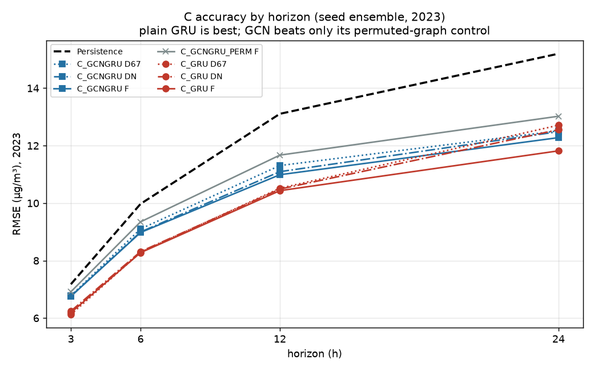
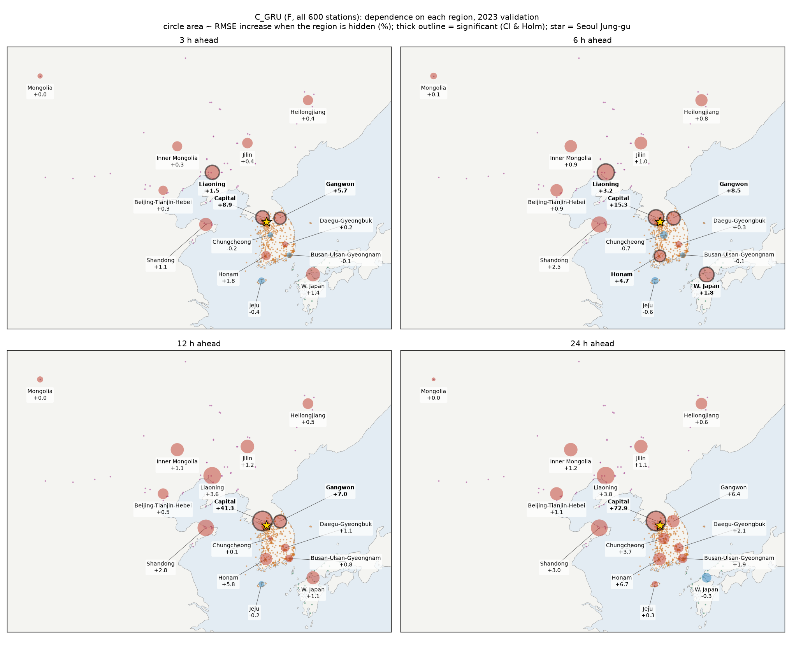
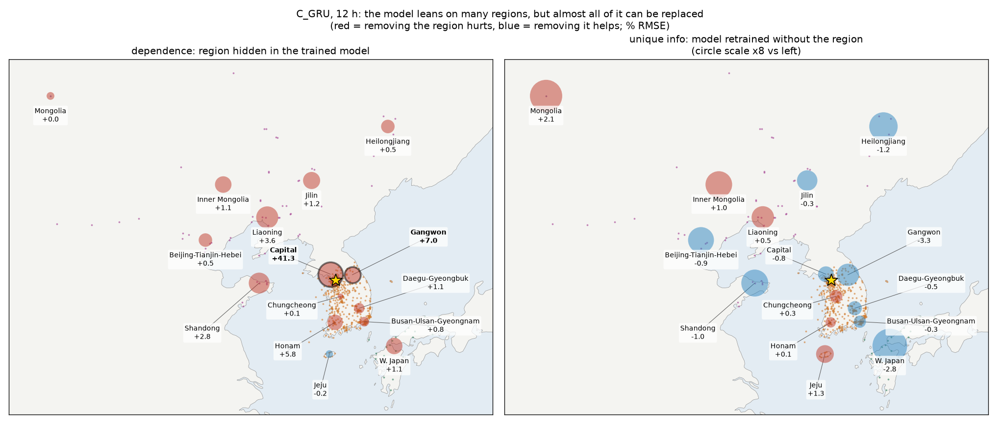

# 모델 C: 그래프 순환신경망으로 본 서울 중구 PM2.5 예측과 권역 기여

서울 중구(KR:111121) PM2.5의 **3·6·12·24시간 뒤 값**을 예측합니다. 국내·중국·일본·몽골 측정소를 노드로 쓰고, 다음 두 가지를 검증합니다.

- 어느 권역의 관측이 예측에 도움이 되는가
- 지리 그래프(GCN)가 그 정보를 더 잘 쓰는가

| 항목 | 내용 |
|---|---|
| 모델 | `C_GRU`(그래프 없음), `C_GCNGRU`(거리 기반 지리 그래프), `C_GCNGRU_PERM`(무작위로 섞은 그래프, 대조) |
| 입력 | 최근 48시간 × 측정소의 log1p PM2.5와 관측 마스크, ASOS 108/102 기상, 시각·연중 sin/cos |
| 출력 | t+3/6/12/24시간 서울 중구 PM2.5 (마지막 관측값 + 학습된 변화량) |
| 분할 | 학습 2021–22, 검증 2023, 시험 2024(`--final`로 한 번만 엽니다) |
| 시드 | 조건마다 11/22/33, 세 예측을 평균한 앙상블로 평가 |
| 평가 | 팀 공통 채점기: DM 검정, 7일 블록 bootstrap, Holm 보정. **구간 상한 < 0 그리고 Holm p < 0.05**일 때만 "개선"으로 판정 |

## 결과 (2023 검증, RMSE µg/m³)

| 모델 | 3 h | 6 h | 12 h | 24 h |
|---|---|---|---|---|
| Persistence | 7.18 | 9.97 | 13.11 | 15.20 |
| **C_GRU (F)** | **6.19** | **8.28** | **10.43** | **11.82** |
| C_GCNGRU (F) | 6.76 | 8.98 | 10.99 | 12.28 |
| C_GCNGRU_PERM (F) | 6.92 | 9.35 | 11.67 | 13.02 |
| C_GRU (DN + 랴오닝)* | 6.00 | 7.90 | 10.01 | 11.61 |

\* 전체 조건 중 RMSE가 가장 낮지만, Holm 보정 후 국내 기준선(DN) 대비 유의하지 않습니다.



**주요 결론**

- **GRU가 GCN보다 낫습니다.** 3·6시간에서 유의합니다. 지리 그래프는 무작위 그래프보다는 낫지만, 그래프가 없는 편이 더 좋습니다.
- **수도권 관측은 대체할 수 없습니다.** 수도권을 빼고 다시 학습하면 3시간 RMSE가 유의하게 나빠집니다(+0.36).
- **국외 권역에 모델이 기대기는 하지만, 그 정보는 다른 측정소로 대체됩니다.**
  - 학습된 모델에서 랴오닝·산둥을 가리면 오차가 늘어납니다(의존도).
  - 그 권역을 빼고 다시 학습하면 차이가 사라집니다(고유 정보 없음).
- **중국 의존도는 추운 계절에 큽니다.** 12시간 기준 산둥 4.7%, 따뜻한 계절 0.4%입니다.





가설별 판정, 시드 구성(계획 177회 중 168회 완료), 그림 전체는 [results/C/RESULTS_C.md](../results/C/RESULTS_C.md)에 있습니다.

## 코드 (`C/`)

| 파일 | 역할 |
|---|---|
| `cdata.py` | 팀 데이터(v5) 읽기, 노드·권역·조건 구성 |
| `experiments.py` | 사전에 고정한 실험 목록과 재개 가능한 실행기 |
| `train.py` | 모델 × 조건 × 시드 한 번 학습하고 예측 저장 |
| `occlude.py` | 학습된 F 모델에서 권역 가리기(재학습 없음) |
| `score_all.py` | 팀 채점기로 모든 묶음 채점, 가설 표 생성 |
| `region_contribution.py` | 권역별 의존도·고유 정보·추가 정보 표와 그림 |
| `plot_map.py`, `plot_summary.py` | 지도와 요약 그림 |
| `test_causal.py` | 누수 검사(t 이후 값을 바꿔도 예측이 변하지 않는지) |

## 실행

데이터(`data_v5`, `Dataset/`와 `Model/`이 있는 폴더)는 저장소에 없습니다. 환경변수 `TSA_DATA`나 `--data`로 위치를 지정합니다.

```bash
pip install -r requirements.txt
python C/experiments.py --workers 2     # 전체 학습, 이어서 실행 가능 (GPU 권장)
python C/occlude.py
python C/score_all.py --split validation
python C/region_contribution.py --split validation
python C/plot_map.py && python C/plot_summary.py
```

학습된 가중치(`model.pt`, 168개, 134 MB)는 용량 때문에 올리지 않았습니다.
