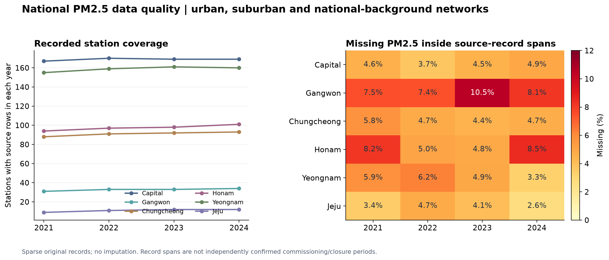

# 전국 PM2.5 자료 품질과 기존 값 보존

## 무엇을 나타내는가

2021–2024년 도시대기·교외대기·국가배경 자료에서, 권역별로 원본 행이 존재하는 측정소 수와 관측 기록 구간 안의 PM2.5 결측 비율을 보여줍니다. 도로변·항만 등 제외 측정망은 농도 분석에 추가하지 않고 메타데이터로 구분했습니다.

## 무엇을 알 수 있는가

- 전국 추출 단계에서573개 지점의 원본 기록을 확인했습니다. 이 수는 현재 모델의 외부 국내514개 선정 수와 다릅니다.
- 기존 국내34개 및 동쪽 후보36개의 PM2.5와 품질 분류를 전수 대조했으며, 비교한 값·flag 불일치는0개였습니다.
- 결측을 채우지 않았습니다. 큰 양수는 농도가 크다는 이유만으로 삭제하지 않았습니다.

## 표와 코드

- `Results/station_year_quality.csv`: 지점·연도별 유효값·결측·원본 행 부재
- `Results/region_year_quality.csv`: 그림에 사용한 권역·연도 집계
- `Results/new_domestic_stations.csv`: 새로 추가한 국내 관측소
- `Results/excluded_roadside_stations.csv`, `excluded_network_metadata.csv`: 제외된 측정망의 메타데이터
- `Results/legacy_preservation.csv`, `quality_summary.json`: 기존 값 보존과 실행 검증
- `Codes/plot_quality.py`: 저장된 권역 집계표로 그림 생성

원본 그림 코드는 같은 이름의 PNG를 작성하므로, 결과를 보존하려면 별도 작업 복사본에서 실행합니다. 전체 추출·품질 재계산에는 별도 Dataset과 그 생성 코드가 필요합니다.

## 해석 제한

원본의 최초–최종 기록은 공식 개소·폐쇄 기간과 같다고 단정할 수 없습니다. 관측소 수와 결측 비율은 예측 성능이나 관측소의 예측 중요도가 아닙니다. 이 감사 단계의 `train_quality_eligible` 수를 현재 모델 선정 수와 동일시하지 않습니다.
