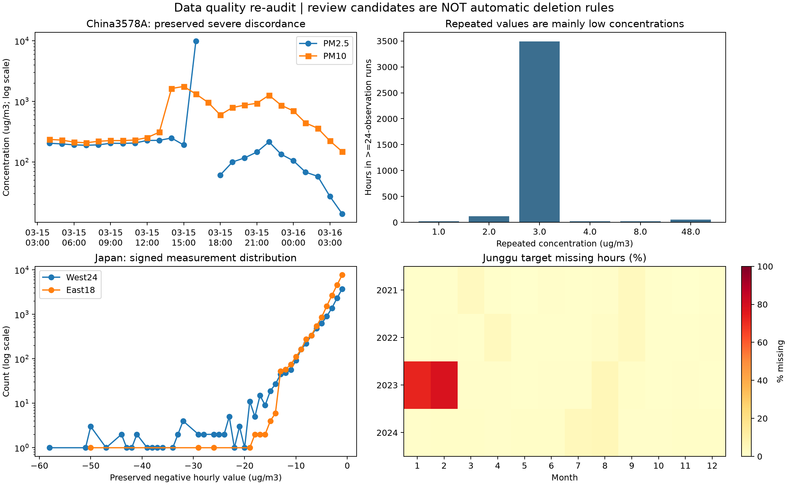

# 현재 모델 입력의 결측·극단값 재점검

## 무엇을 나타내는가

국내514개, 중국77계열, 일본 서부24·동부18, 몽골1개와 중구 정답·기상·궤적 자료를 구분해 점검했습니다. 원자료의 극단값이 현재 DCRNN 입력에 실제로 들어가는지, 기존 QC가 어느 자료까지 적용됐는지도 확인했습니다.

## 주요 발견

- 중국 탕산3578A의2021-03-15 16시KST PM2.5=9,985는 현재 입력에 남아 있습니다. 같은 시각 PM10=1,327 및 전후 관측과 크게 불일치하는 오류 의심값입니다.
- 신규 중국 도시평균에서 격리한 극단값과, 기존48개 측정소에 남은 값을 구분해야 합니다. 기존 QC가 중국 전체를 정리한 것은 아닙니다.
- 중국의24개 이상 연속 동일값3,741시간 중3,493시간은 농도3입니다. 반복값 전체를 센서 고장으로 확정할 수 없습니다.
- 중구의 가장 긴 공백은2023-01-09 12시부터02-22 20시까지1,065개 시간값입니다. 몽골의2023 결측률은82.386%입니다.
- 일본 음수를 일괄0으로 바꾸는 방법도 평균을 바꿉니다. 공식 관측 유효성과 변환 방식을 함께 검토해야 합니다.

[극단 사례 비교 그림](Results/Extreme_Event_Review_20261109/extreme_value_contexts.png)과 같은 폴더의 사례 기록은 오류 의심값과 실제 고농도 근거를 나눠 설명합니다. 울진803은 동일 날짜·시각·농도를 보고한 산불 연구가 있지만, 중국 설날 급등은 개별 관측 원인을 모두 독립 검증한 것은 아닙니다.

## 파일과 재현 범위

`Results/current_model_scope_quality.csv`는 실제 선택 입력의 요약이며, `Results/Extreme_Event_Review_20261109/README.txt`는 사건별 시간·장소·출처를 제공합니다. `Codes/audit_*.py`와 `review_extreme_events.py`는 원자료를 다시 읽는 감사 코드로 별도 Dataset 및 모델 설정이 필요합니다. 저장된 표·그림은 원자료 없이 읽을 수 있습니다.

이번 작업은 점검이며 데이터 수정이나 재학습이 아닙니다. QC를 바꾸면 성능이 좋아진다는 결과는 아직 없습니다. 반복이나 급등을 미래 정보를 이용해 소급 판정하는 운영 규칙도 피해야 합니다.
