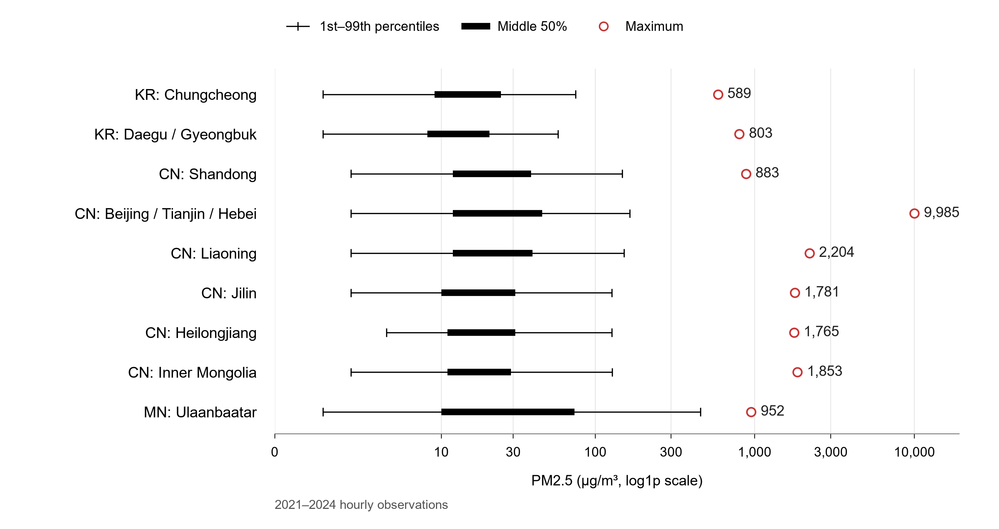

# 일반적인 PM2.5 범위와 극단값의 구분



## 그림 읽는 방법

검은 가는 선은1–99백분위 범위, 굵은 부분은가운데50%(IQR), 빨간 빈 원은최댓값입니다. 빨간 원은 **확정 오류 표시가 아닙니다**. 통계는2021–2024년 선택된 시간별 관측의 원단위로 계산했고, 표시 축만log1p를 사용했습니다.

## 무엇을 알 수 있는가

일반적인 농도 범위와 드문 극단값 사이의 간격을 관측소·권역별로 비교할 수 있습니다. 예를 들어 탕산9,985와 울진803은 모두 큰 값이지만, 전자는 강한 관측 불일치가 있고 후자는 산불 관측 근거가 있으므로 같은 상한으로 자동 제거할 수 없습니다. 사건 해석의 근거는 [현재 입력 품질 재점검](../02_input_quality/README.md)에 있습니다.

## 저장 자료

- `pm25_percentile_range_regions.*`: 최댓값500초과 권역
- `pm25_percentile_range_all_17_regions.*`: 전체17권역
- `pm25_percentile_range_representative_stations.*`: 탕산·안산·울진·울란바토르 사례
- `region_box_stats.json`, `station_box_stats.json`: 재그리기용 분포 요약
- `series_inventory.csv`, `extreme_observations_gt500.csv`: 입력 목록과 검토 후보

## 집계표로 재그리기

이 폴더에서 Git Bash로 실행합니다. numpy·matplotlib이 필요하며 원본 Dataset 없이 저장된 JSON으로 그림을 생성합니다.

```bash
python Codes/plot_percentile_ranges.py --output "Results/replot_$(date +%Y%m%d_%H%M%S)"
```

`profile_current_inputs.py`를 통한 통계 재계산에는 Dataset과Model/Common 설정이 별도로 필요합니다. 기존 원자료와 분석값은 이 그림 작업에서 변경하지 않았습니다.

## 해석 제한

풀링한 시간값 분포이므로 관측소 수·가용 시간·서로 다른 사건이 함께 반영됩니다. 권역의 최댓값이 해당 권역 전체의 대표 농도나 서울에 대한 기여를 뜻하지 않습니다.
