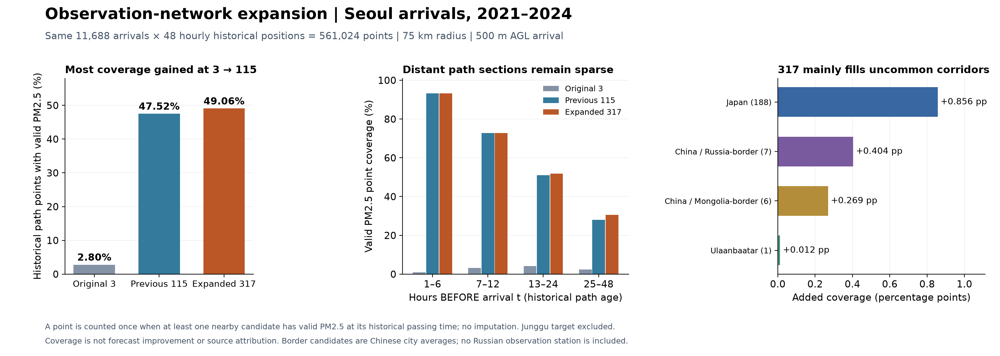

# 초기 관측망 확장의 과거 경로 연결률

## 무엇을 나타내는가

2021–2024년 서울 도착500m AGL 역궤적11,688개의 과거1–48시간 위치561,024개를 기준으로, 반경75km 안에 당시 유효한 PM2.5 관측이 하나 이상 있는 위치의 비율을 계산했습니다. 초기 외부3곳은 백령도·Weihai1662A·Shunyi1008A이며, 중구 타깃은 제외했습니다.

## 주요 결과

- 초기3곳: **2.8020%**
- 이전115후보: **47.5179%**
- 확장317후보: **49.0598%**

관측 연결의 큰 개선은3→115에서 나타났습니다(+44.7159%p). 이후115→317은+1.5418%p이지만, 1,686개 도착 궤적에서 추가 과거 관측을 확보했습니다. 일본188개 대신 균형판24개를 쓰는153후보 구성은48.9034%였습니다.

## 자료와 코드

`Results/network_coverage.csv`가 전체 비교, `coverage_by_path_age.csv`가 과거 시차 구간, `coverage_by_12h_route_sector.csv`가12시간 전 위치 방위별 결과입니다. `new_candidate_coverage.csv`와 `new_station_point_connections.csv`는 추가 후보의 연결을 보여줍니다. `coverage_audit.json`에 정의와 검증을 기록했습니다.

`Codes/plot_network_coverage.py`는 저장된 CSV로 그림을 만듭니다. 원본 코드는 같은 이름에 저장하므로 재그리기는 별도 작업 복사본에서 실행합니다. `analyze_network_coverage.py`로 전체 연결을 재계산하려면 원본 데이터 ZIP이 필요합니다.

## 해석 제한

이는 **과거 후보 범위의 역사적 분석**입니다. 현재 DCRNN의634계열과 혼동하지 않습니다. 연결률은 예측 오차 감소나 국가별 배출 기여율이 아닙니다. 25–48시간 전 경로를 잘 관측한다는 사실만으로24·48시간 후 예측이 좋아진다고 결론낼 수 없습니다. 수평 거리만 사용했으므로 고도·혼합고와 실제 수송 가능성은 별도 문제입니다.
