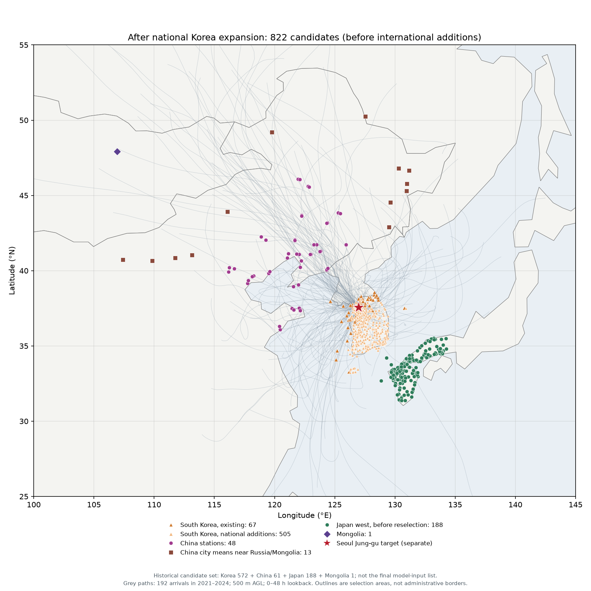

# 전국 국내 후보 추가의 관측 연결률

위 그림은 [확장 단계 지도06](../06_station_expansion_maps/README.md)의 지리적 맥락입니다. 이 분석 자체의 정량 결과는 아래 CSV·JSON에 있으며 별도 요약 그림을 생성하지 않았습니다.

## 무엇을 계산했는가

2021–2024년 서울 도착500m AGL 궤적11,688개, 과거1–48시간 위치561,024개, 반경75km의 동일 기준에서 국내 기존67곳과 당시 전국572후보를 비교했습니다. 실제 과거 관측만 사용했고 보간하지 않았습니다.

## 주요 결과

- 국내67후보 연결률 **37.2143% → 전국572후보41.6676%**, **+4.4533%p**
- 주변국까지 포함한317→822후보 연결률 **49.0598% → 53.4113%**

중남부 관측망 추가로 기존 서쪽·수도권 중심망이 놓치던 경로 위치의 관측 가능성을 보완했습니다. 권역별 추가 연결 지점은 서로 겹칠 수 있으므로 권역 수치를 단순히 더하면 전체 증가분이 되지 않습니다.

## 자료

- `additional_coverage_region_season_summary.csv`: 권역·계절별 요약
- `additional_coverage_by_region_season_age.csv`: 권역·계절·과거 경로 시차 구간
- `additional_coverage_by_station.csv`: 지점별 연결
- `new_domestic_matching_candidates.csv`: 당시 추가 후보
- `coverage_summary.json`, `integration_verification.json`: 계산 조건과 보존 검증

`Codes/verify_integration.py`는 별도 프로젝트 자료를 사용하는 검증 코드입니다. 저장된 CSV·JSON은 Dataset 없이 읽을 수 있습니다.

## 현재 모델과의 구분

572는 당시 품질 감사·지리 후보 단계의 국내 외부 후보 수입니다. 현재 모델은 학습기간 가용성과 기존 목록 보존 규칙을 반영한514개를 사용합니다. 따라서 이 결과를 현재514/634 입력의 연결률이라고 표기하면 안 됩니다. `path_age_bin`은 서울 도착 전의 과거시간이며 예측 지평이 아닙니다. 관측 연결 개선은 예측 성능 개선의 증거와 구분합니다.
