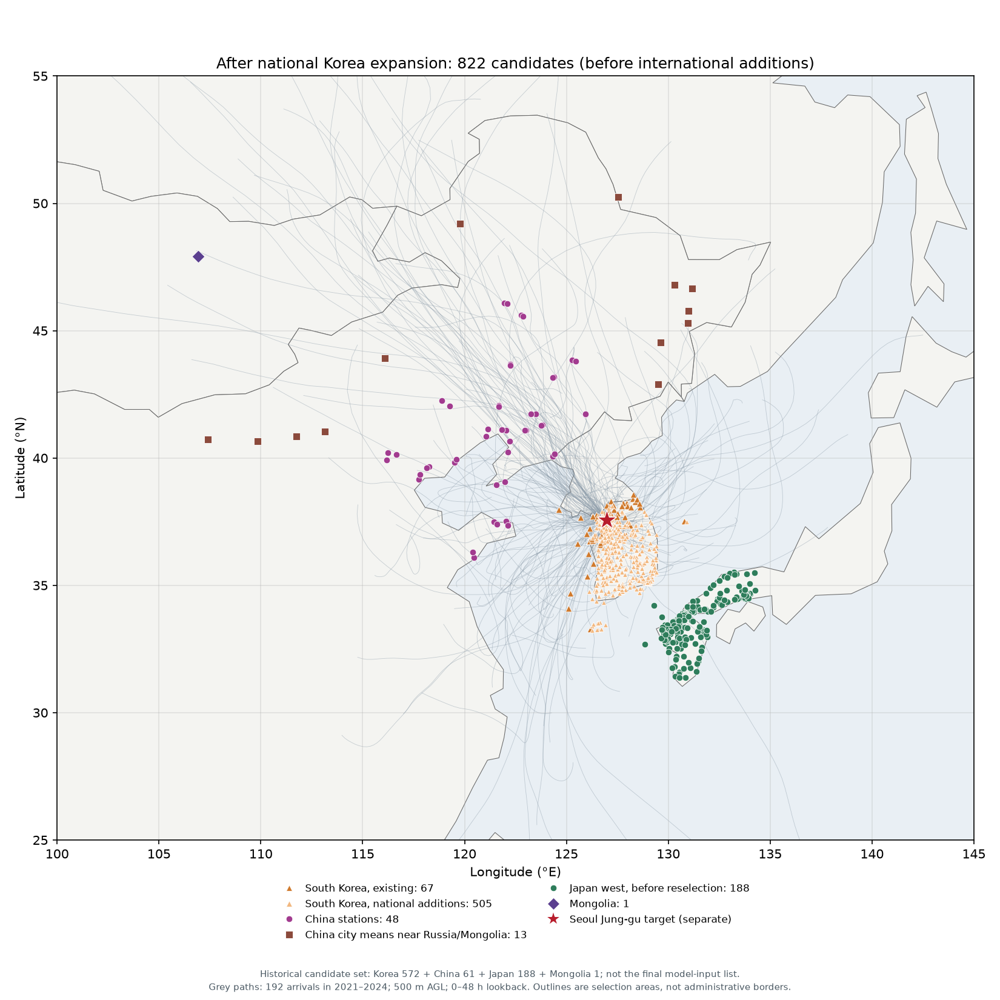
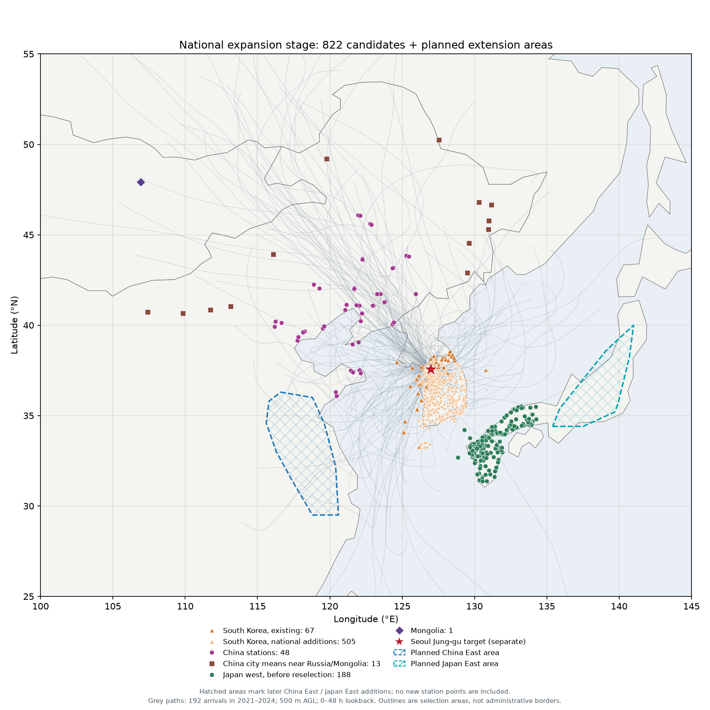

# 관측망 확장 단계와 추가 예정 지역 지도





## 무엇을 나타내는가

전국 국내 후보를 확보한 뒤의 관측망을 이전 지도 형식으로 복원하고, 같은 관측망 위에 중국 동부·일본 동부의 추가 영역을 그물무늬·점선으로 표시했습니다. 두 번째 그림의 영역은 추가 지역을 설명하는 표시이며, 첫 번째 그림에 새 관측값이 입력됐다는 뜻이 아닙니다.

2021–2024년500m AGL 도착 역궤적에서 매월4개씩 선택한192개 경로를 배경으로 사용했습니다. 표본은 모든 경로의 빈도나 국가별 기여율을 대표하도록 추정한 값이 아닙니다.

## 무엇을 알 수 있는가

초기 서해안·수도권 중심 관측망에서 국내 중남부로 넓어진 공간 범위와, 이후 동부 추가 자료가 보완하려던 지역을 한 그림 안에서 비교할 수 있습니다. 이 지도는 **확장 과정의 후보 목록**이며, 실행한 DCRNN의 입력 목록은 [실제 관측망07](../07_dcrnn_actual_network/README.md)에서 확인해야 합니다.

## 재그리기

이 폴더에서 numpy·pandas·pyarrow·matplotlib을 설치하고 실행합니다. 포함된 작은 표본·CSV·GeoJSON을 사용하며 HYSPLIT을 다시 실행하지 않습니다.

```bash
python Codes/plot_station_stages.py --input-root . --output-dir "Results/replot_$(date +%Y%m%d_%H%M%S)"
```

`Results/plotted_candidates_822.csv`는 당시 후보, `display_trajectory_sample.parquet`는 그림의 경로 표본, `planned_region_boundaries.geojson`은 표시 영역입니다. `Codes/assets/countries.geojson`도 필요합니다. 값·좌표 출처와 개수는 원본 manifest에 기록되어 있습니다.

## 해석 제한

측정소 위치는 배출원 위치가 아닙니다. 국경 도시평균은 중국 내 대리 관측이며 러시아 실측이 아닙니다. 과거 후보822를 현재 모델 입력으로 되살려 해석하지 않습니다.
