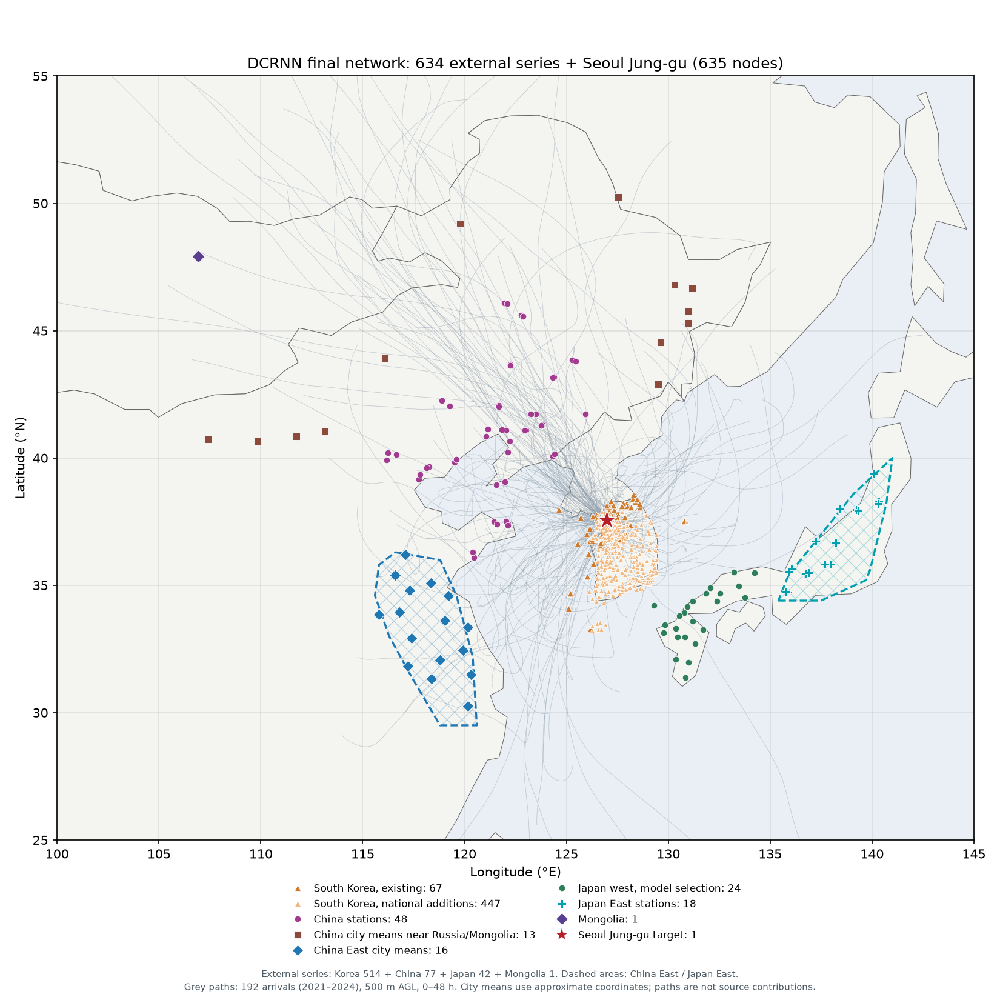

# 실제 DCRNN 입력 관측망: 외부634계열·635노드



## 무엇을 나타내는가

실제 DCRNN 실행 batch `20261112_003040_429483_85af4013`의 여섯 입력 조건에서 보관한 노드 순서·좌표와 현재 `F634_BOTH_W24` 설정을 대조한 지도입니다. 전체 외부 입력은 국내514·중국77·일본42·몽골1이며, 중구 타깃을 포함하면635노드입니다.

- 국내514 = 기존67 + 전국 추가447
- 중국77 = 기존 측정소48 + 국경 중국 도시평균13 + 동부 도시평균16
- 일본42 = 기존 서부24 + 동부18

## 무엇을 알 수 있는가

모델 실험에서 실제로 허용한 관측 정보의 지리적 범위와 자료 종류를 확인할 수 있습니다. M1은 국내만, M2는 국내+가까운 중국21, M3/M3T는 국내+중국77, M4/M4T는 전체 관측을 사용합니다. **모든 조건은 같은635노드와 수송 그래프를 유지**하며, 제외된 관측은 가려지고 노드는 잠재 중계 노드로 남습니다.

따라서 M1은 국내 PM2.5 관측 입력 기준입니다. 국외 위치나 수송 그래프 자체를 제거한 실험은 아닙니다. T는 해당 관측 범위 위에 궤적 요약변수를 추가하는 비교입니다.

## 재그리기

```bash
python Codes/plot_dcrnn_final_network.py --input-root . --output-dir "Results/replot_$(date +%Y%m%d_%H%M%S)"
```

포함된 `final_nodes_635.csv`, `display_trajectory_sample.parquet`, `selected_region_boundaries.geojson`, `Codes/assets/countries.geojson`으로 재현합니다. 모델 학습이나 원본 Dataset은 필요하지 않습니다. `Audit/actual_dcrnn_station_audit.json`은 실제 노드·좌표·그래프 대조 기록입니다.

배경192개 경로는2021–2024년500m AGL 도착 표본입니다. 그림은 오염원이나 국가별 기여율을 추정하지 않으며, 중국29개 도시평균의 좌표는 특정 센서 위치가 아닌 근사 대표점입니다.
