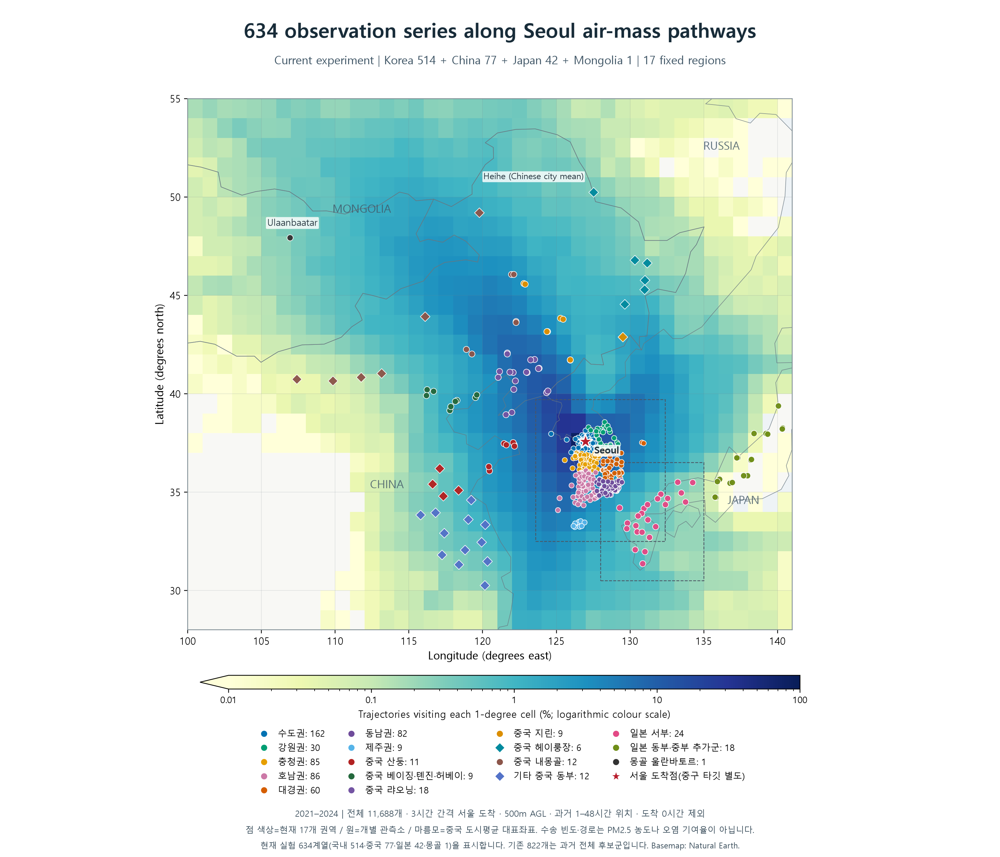
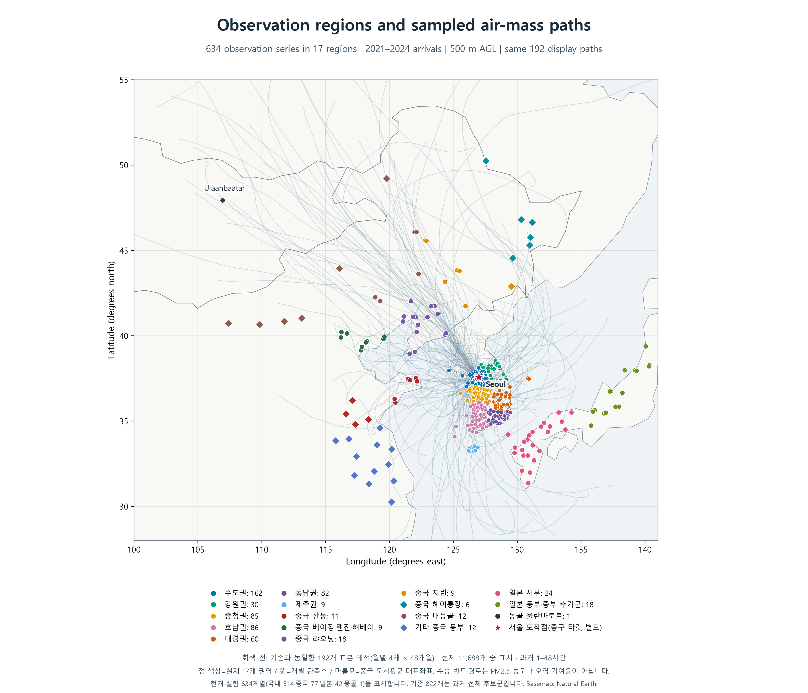

# 17권역 관측망과 HYSPLIT 경로

## 무엇을 나타내는가

현재634개 외부 관측계열을 같은17권역 색상으로 표시하고, 배경을 통과 빈도 히트맵과 표본 궤적으로 나눴습니다. 권역 색상과 개수는 실행용 지역 설정과 대응합니다. 개별 관측소는 원, 중국 도시평균29개는 마름모이며 중구 타깃은 별도 별표입니다.

2021–2024년3시간 간격 서울 도착11,688개, 도착고도500m AGL, 과거1–48시간 위치를 사용했습니다. 히트맵은 각1도 격자를 방문한 **고유 궤적 수 / 전체11,688 ×100**입니다. 같은 궤적의 반복 방문은 한 번만 계산하고0시간 도착점은 제외했습니다. 경로 그림은48개월에4개씩 고른192개 표본입니다.

## 무엇을 알 수 있는가

각 관측 권역이 서울 유입 경로의 어떤 공간 구간에 놓이는지 확인할 수 있습니다. 히트맵의 어두운 색은 자주 지나간 경로이며 높은 PM2.5나 그 권역의 예측 중요도를 뜻하지 않습니다. 드문 경로가 고농도 사건에서 중요한지는 별도 분석이 필요합니다.

## 파일과 재현 범위

`Results/Run_20261110_135541_150521_8dffa483/`에 실제 표시 목록, 권역 개수·색상, 표본 도착시각과 검증 manifest가 있습니다. `Codes/region_color_scheme.csv`는 공통 색상표입니다.

`plot_separate_region_maps.py`는 `--project-root`를 지원하지만 원래 Dataset의 궤적, 공통 지역 설정, 이전 검증·색상 경로가 필요합니다. 이 공유 폴더만으로 전체 재계산이 가능하다고 가정하지 않습니다. 포함된 그림과 작은 표는 Dataset 없이 열람할 수 있습니다.

현재 일본 동부 그룹은 확보한 추가 자료의 묶음이며 엄밀한 일본 전체의 동서 지리 경계를 의미하지 않습니다. 러시아 실측 관측소는 포함되지 않습니다.
