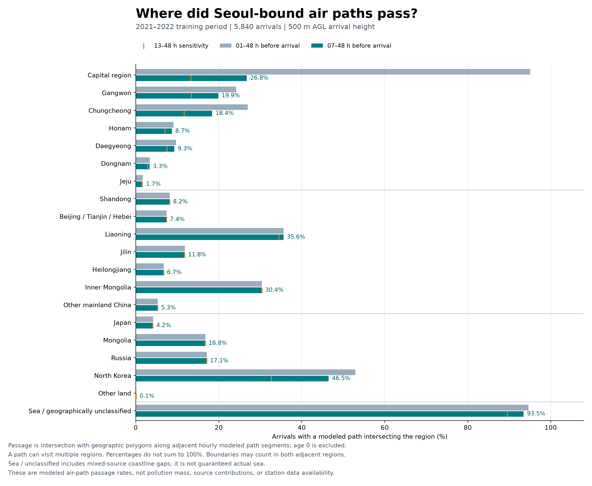
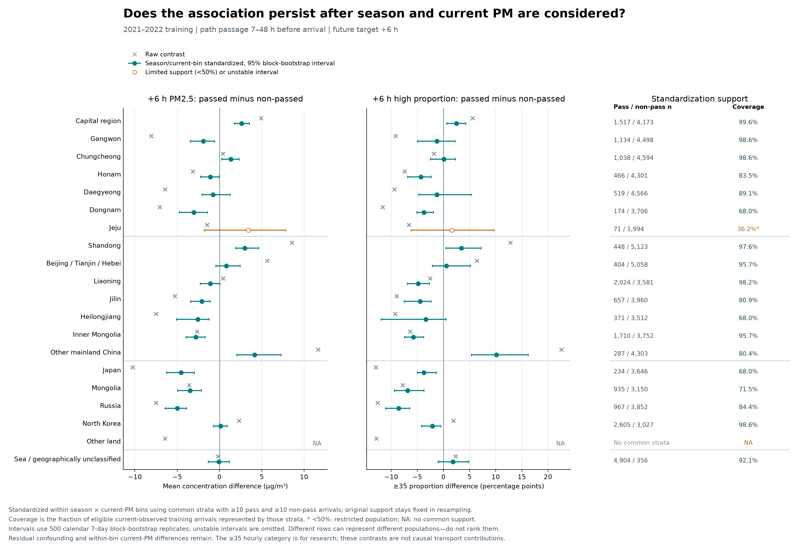

# 학습기간 권역 통과와 이후 중구 PM2.5

## 분석 질문과 범위

서울로 오는 공기가 어느 지리적 권역을 지났는지에 따라3·6·12·24시간 후 중구 평균 농도와 고농도 비율이 어떻게 다른지 탐색했습니다. 입력 선정과 가설 설계에 사용할 분석이므로 **2021–2022년 학습기간만** 사용했습니다.

500m AGL 도착5,840개 궤적의 시간별 위치를 연결한 선분과 행정경계를 교차해 통과를 판단했습니다. 주 분석은 도착 직전6시간을 제외한 **07–48시간 경로**입니다. 계절4개 × 현재 중구 농도4구간으로 층화하고, 비교 가능한 공통층에서 표준화했습니다. 고농도는 연구용 시간값 PM2.5≥35µg/m³이며 공식 경보 기준 재현이 아닙니다.

## 주요 발견

- 수도권 통과율은01–48시간95.03%에서07–48시간26.78%로 낮아집니다. 서울 도착이라는 조건 자체가 만드는 근접 효과를 구분해야 합니다.
- 랴오닝 통과율35.62%, 내몽골30.39% 등 자주 지나오는 지역과 높은 이후 농도가 연결되는 지역은 같지 않았습니다.
- 산둥 통과 후6시간 평균은27.84µg/m³, 고농도 비율24.58%로 전체 평균19.99·12.81%보다 높았습니다. 그러나 통과·미통과 평균차는 계절·현재농도 조정 후+8.56에서+2.98µg/m³로 줄었습니다.
- 랴오닝 통과율은 겨울71.04%, 여름8.49%였습니다. 일본 겨울 통과 표본은6시간 기준2개여서 계절별 가용 표본을 함께 봐야 합니다.

## 무엇을 알 수 있고, 무엇을 확정할 수 없는가

경로·계절·현재 농도를 고려한 권역 구분 실험의 근거가 됩니다. 다만 이 관계는 배출 기여나 관측소 추가의 예측 성능 향상이 아닙니다. 권역별 공통층이 달라 조정 차이를 단순 순위로 읽을 수 없고, 탐색적7일 블록 부트스트랩 구간은 다중비교를 거친 확정적 유의성이 아닙니다.

## 결과와 코드

`Results/report.html`과 `report.txt`가 상세 보고서입니다. `primary_6h_summary_ko.csv`, `passage_rates.csv`, `raw_region_future_outcomes.csv`, `adjusted_region_contrasts.csv`, `seasonal_region_future_outcomes.csv`에 표본 수와 추정값이 있습니다. 경계 정의는 `region_definitions.csv`와 `Codes/GEOGRAPHIC_CLASSIFICATION.md`를 확인합니다.

`plot_results.py`는 `--eda-root`를 지원합니다. 통계 그림은 저장된 CSV로 재그릴 수 있지만, 경로 지도에는 분류된 경로 Parquet와 경계 GeoJSON이 필요합니다. `make_report.py`에는 `origin_analysis_table.parquet`도 필요합니다. 원자료부터 분류·통계를 다시 계산하는 작업에는 별도 Dataset이 필요합니다. 기존 결과를 덮어쓰지 않도록 재현은 분리된 작업 복사본에서 수행합니다.
