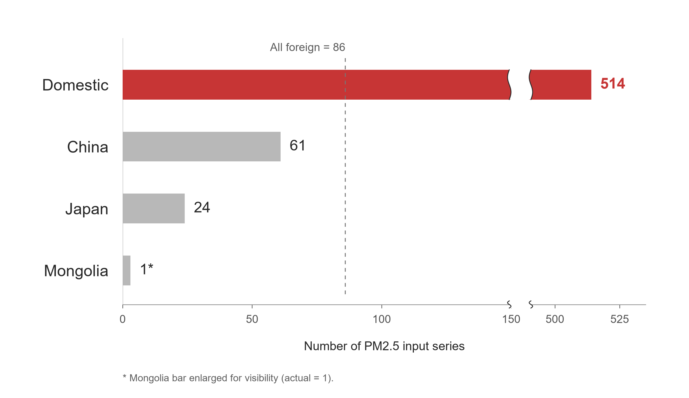

# 동부 추가 전 F600 입력 수 비교

## 무엇을 나타내는가

중국 동부16개·일본 동부18개를 추가하기 전의 `F600_W24` 관측 입력입니다. 기존 일본 서부24개를 유지하고 재선정25개는 포함하지 않습니다. 서울 중구 타깃은 수에서 제외했습니다.

| 입력 | 계열 수 |
|---|---:|
| Domestic | 514 |
| China | 61 |
| Japan | 24 |
| Mongolia | 1 |
| 국외 합계 | **86** |
| 외부 입력 합계 | **600** |

중구를 포함한 그래프는601노드입니다. `F600_station_keys.csv`에 실제 목록, `actual_country_counts.csv`에 그림 수치를 기록했습니다. 설정 목록은 원래 지역 실험의F와 순서까지 일치함을 확인했습니다.

## 무엇을 알 수 있는가

국내 관측계열이 국외 합계보다 약6배 많습니다. 이는 국내 정보를 줄이거나 권역별 요약을 사용한 비교를 검토할 근거지만, 국내만 쓴 모델이 좋았던 원인을 입증하지는 않습니다. 수가 같은 관측소가 같은 정보량을 제공하는 것도 아닙니다.

## 그림 표시와 재현

국내는 빨강, 국외는 같은 회색입니다. 가로축의150–490 구간은 물결로 생략했고 두 보이는 축 구간의 단위당 길이는 같습니다. 몽골 막대는 가시성을 위해 표시 폭만 넓혔으며 실제값1을 별표 주석으로 밝혔습니다.

`Codes/plot_pre_east_balance.py`가 생성 코드이며 두 실험 설정을 대조해 수를 계산합니다. 설정 사본은 `Evidence/`에 있습니다. 다른 PC에서 원본 절대경로를 쓰지 않도록 공유본의 설정 읽기 경로를 확인해야 합니다.

## 현재 DCRNN 결과와 구분

최근 DCRNN M1–M4T 결과는 외부634계열의 고정 노드 실험입니다. 이600계열 그림을 그 실험의 실제 입력 설명으로 붙이지 않습니다. 현재 입력 수는 [F634 비교11](../11_input_balance_dcrnn634/README.md)에서 확인합니다.
