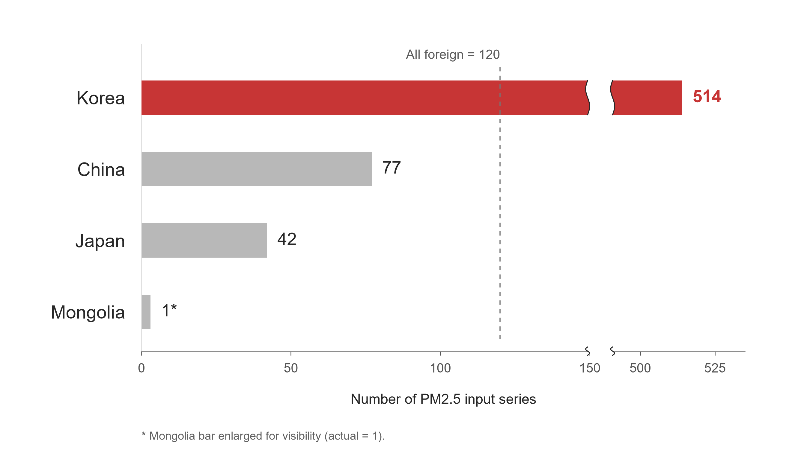

# 실행한 DCRNN F634 입력 수 비교

## 무엇을 나타내는가

실제 실행 노드 목록과 대조한 `F634_BOTH_W24`의 전체 외부 관측 입력입니다. 국내514·중국77·일본42·몽골1로 외부634계열이며, 중구 타깃을 포함하면635노드입니다. 국외 합계는 **120**입니다.

국내514는 도시대기·교외대기·국가배경이며 도로변을 포함하지 않습니다. 일본42는 기존 서부24+동부18입니다. 일본 서부 재선정 후보까지 합친58개와 구분합니다. 중국77에는 측정소48개와 도시평균29개가 함께 포함됩니다.

## 무엇을 알 수 있는가

전체 입력에서 국내 계열 수가 국외 합계의 약4.28배입니다. 수적 불균형과 중복성이 국외 추가 이득을 가릴 가능성은 후속 비교 가설입니다. 국외 입력이 불필요하다거나, 개수 때문에 성능이 악화됐다고 확정하는 그림은 아닙니다.

후속 비교에서는 국내 전체/국내 대표 부분집합 × 국외 없음/있음의 조합을 같은 평가 행에서 재학습하면 국내 축소 자체의 효과와 국외 추가 효과를 구분할 수 있습니다. 대표 입력의 선택 기준은 학습·검증 자료에서 정합니다.

## 표시와 코드

국내는 빨강, 국외는 회색입니다.150–490 구간을 물결로 생략했고 보이는 양쪽 축의 단위당 길이를 일치시켰습니다. 몽골 막대는 가시성용 최소 폭이며 실제값은1입니다.

`Results/actual_country_counts.csv`는 원본 생성 과정의 범위별 수를 함께 기록할 수 있으므로 이 그림은 `dcrnn634` 행을 읽습니다. `eda650`의일본58·국외136을 현재 실험 수로 사용하지 않습니다. 생성 코드의 공유용 경로 처리와 실제 노드 수 검증을 함께 확인합니다. 실험별 활성 입력은 M1부터M4T까지 다르므로634개가 모든 조건에서 관측값으로 사용되는 것은 아닙니다.

[실제 관측망 지도](../07_dcrnn_actual_network/README.md) · [동부 추가 전600 비교](../10_input_balance_pre_east600/README.md)
