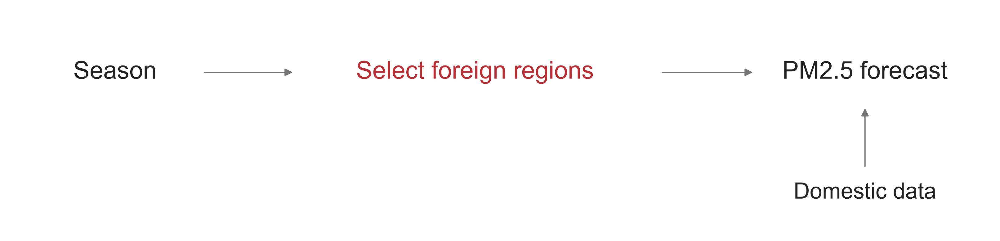

# Future Work: 계절·경로에 따른 국외 입력 선택



## 무엇을 제안하는가

국내 관측을 공통 기준선으로 유지하면서, 계절 또는 예측 당시의 유입 경로에 따라 사용할 국외 권역을 선택하는 모듈형 시스템의 방향을 보여줍니다. 특정 계절에 특정 국가가 반드시 도움이 된다는 대응표를 확정한 그림은 아닙니다.

## 왜 검토하는가

국외 정보를 모든 상황에 일괄 추가했을 때의 연평균 이득이 작아도, 특정 계절·수송 상황에는 정보 가치가 다를 수 있습니다. 후속 실험에서는 권역별 개별 추가·재학습 비교와 경로 조건별 성능, 표본 수·불확실성을 확인해야 합니다. 이 개념도 자체에는 성능 수치나 학습된 가중치가 없습니다.

선택 규칙은 예측 시점까지 알 수 있는 계절·현재 경로 등으로 정의하고 validation에서 정합니다. 미래 실제 농도나 미래에 도착할 공기의 사후 경로로 입력을 선택하면 운영 시 사용할 수 없는 정보가 들어갑니다. 적은 표본에서 보인 효과를 확정하지 않고 독립 기간의 확인을 남겨둡니다.

## 재그리기

matplotlib만으로 그림을 생성하며 관측 Dataset은 필요하지 않습니다. 기존 파일과 분리된 출력 폴더를 지정합니다.

```bash
python Codes/make_concept_figure.py --output "Results/replot_$(date +%Y%m%d_%H%M%S)"
```

`Results/concept_manifest.json`에 이 그림이 실험 증거가 아닌 후속 연구 방향이며, 국가·계절 대응이나 성능 개선을 주장하지 않는다는 범위를 기록했습니다.
