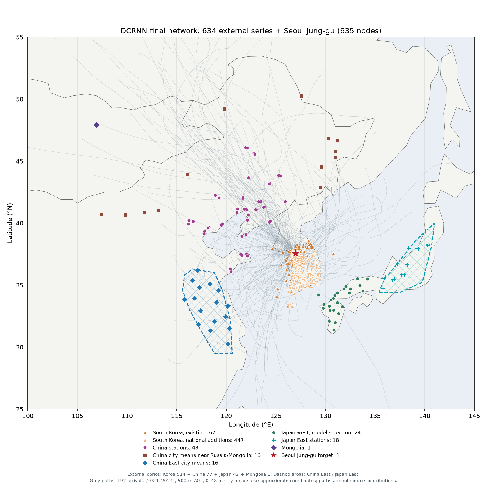

# D 담당 EDA 공유 자료

관측망을 서울·백령도·Weihai·Shunyi 중심 구성에서 전국·주변국으로 확장하며 수행한 데이터 점검과 탐색 분석입니다. 각 폴더에는 그림·집계표·생성 코드와 해석을 함께 모았습니다. 원자료와 기존 팀원의 분석은 변경하지 않았습니다.



## 읽는 순서

| 자료 | 무엇을 확인하는가 |
|---|---|
| [01 전국 자료 품질](01_national_quality/README.md) | 전국 추출 범위, 결측, 기존 데이터 보존 |
| [02 현재 입력 재점검](02_input_quality/README.md) | 극단값·반복값·일본 음수·중구 정답 공백과 실제 입력 상태 |
| [03 극단값 분포](03_extreme_values/README.md) | 일반적인 농도 범위와 매우 큰 값의 구분 |
| [04 초기 관측망 확장 연결률](04_network_coverage_history/README.md) | 외부 3 → 115 → 317 후보가 과거 경로 관측을 얼마나 보완했는가 |
| [05 전국 확대 연결률](05_national_coverage_history/README.md) | 당시 국내 67 → 572 후보의 추가 연결 지점 |
| [06 관측망 확장 단계 지도](06_station_expansion_maps/README.md) | 전국 확대와 동부 추가 지역의 지리적 맥락 |
| [07 실제 DCRNN 관측망](07_dcrnn_actual_network/README.md) | 실행한 634개 외부 계열·635노드의 정확한 범위 |
| [08 17권역과 수송 경로](08_regions17_transport/README.md) | 통과 빈도 히트맵과 표본 궤적을 분리해 보기 |
| [09 학습기간 경로·미래 농도](09_routes_future_pm25_training/README.md) | 계절·현재 농도를 고려한 권역 통과와 이후 중구 농도 관계 |
| [10 동부 추가 전 입력 수](10_input_balance_pre_east600/README.md) | Domestic514 대 국외86의 기존 F600 구성 |
| [11 현재 DCRNN 입력 수](11_input_balance_dcrnn634/README.md) | Domestic514 대 국외120의 F634 구성 |
| [12 계절별 선택의 후속 방향](12_seasonal_selection_concept/README.md) | 향후 검증할 선택적 국외 입력 구조의 개념 |

모델 학습·추론 결과는 [DCRNN 결과와 2023 validation 발표 자료](../../results/D/DCRNN/presentation2023/README.md)에서 확인합니다.

## 개수를 혼동하지 않기

아래 수는 서울 중구 타깃을 제외한 외부 관측계열입니다. 중국에는 도시평균도 포함되므로 전부 개별 센서 수는 아닙니다.

| 구성 | 국내 | 중국 | 일본 | 몽골 | 외부 합계 |
|---|---:|---:|---:|---:|---:|
| 기존 F600_W24 | 514 | 61 | 24 | 1 | 600 |
| 실행한 DCRNN F634_BOTH_W24 | 514 | 77 | 42 | 1 | 634 |
| 동부 제외 후보 합집합 | 514 | 61 | 40 | 1 | 616 |
| 전체 후보 합집합 | 514 | 77 | 58 | 1 | 650 |

일본 서부 기존24와 재선정25는 공통9개입니다. 두 목록을 합치면40개이고, 동부18을 더하면58개가 됩니다. DCRNN은 기존 서부24에 동부18을 더한42개를 사용했습니다. 후보 합집합616·650은 단일 모델의 실제 입력 수가 아닙니다. 과거 지도에 나오는572·822 역시 당시 후보 목록이며 현재514·634 모델 선정 수와 구분해야 합니다.

## 공통 해석 원칙

- 2021–2024 지도·품질 분석은 전체 기간의 기술통계입니다. 관측소 선정과 미래 농도 관계를 탐색한 분석09는 2021–2022 학습기간을 사용합니다.
- 통과 빈도, 관측 연결률, 미래 농도와의 관계, 모델 입력의 추가 예측 이득은 서로 다른 지표입니다. 어느 것도 국가별 배출 기여율로 바꿔 해석하지 않습니다.
- 러시아 실측 자료는 없습니다. 러시아·몽골 국경 근처의 중국 도시평균은 중국 관측 대리자료입니다.
- 2023 중구 정답에는 겨울 약44일의 긴 공백이 있습니다. 몽골의2023 결측률은82.386%여서 효과 부재를 확정하기 어렵습니다.
- 수적 불균형·이상값·특징 결합 방식은 성능 개선 부재의 가능한 설명입니다. 원인으로 입증하려면 같은 평가 행에서 통제된 재학습 비교가 필요합니다.

그림 열람에는 Dataset이 필요 없습니다. 재그리기는 분석별 작은 집계표와 자산으로 가능한 범위를 각 README에 적었습니다. 원자료부터 재계산하는 코드는 별도 Dataset·HYSPLIT 결과·공통 설정이 필요하며, 개인 경로가 남은 원본 코드를 다른 PC에서 그대로 실행할 수 있다고 가정하지 않습니다.


## 공유본의 경로 및 재현 검사

저장소 루트에서 코드 누락·버전 검사와 대표 그림 재생성을 실행할 수 있습니다.

```bash
python D/verify_share.py --code-only
python -m pip install -r D/requirements_figures.txt
python D/reproduce_figure.py validation_curve
python D/reproduce_figure.py pre_east_counts
```

`reproduce_figure.py`는 입력 표·자산을 새 실행 폴더로 복사해 그리므로 기존 그림을 덮어쓰지 않습니다.
`actual_network`, `expansion_stages`, `outlier_ranges`, `current_counts`, `seasonal_concept`, `all`도 선택할 수 있습니다.
결과는 `results/D/reproduced/Run_...`에 저장합니다. 이 경량 재그리기는 모델 학습이나 원자료 재처리가 아닙니다.
모든 원자료부터 재계산하는 분석은 각 README의 Dataset 의존성을 따릅니다.
