# EDA (탐색적 자료 분석)

전체 계획은 [PLAN.md](PLAN.md)에 있습니다. 이 문서는 **1단계(E0·E1·E2·E5·E9)** 결과입니다.

- **기간:** 학습 구간 2021–22만 씁니다. E9만 2023 검증 예측을 쓰고, 2024는 쓰지 않습니다.
- **실행:** 저장소 옆에 `data_v5`를 두거나 `TSA_DATA`로 위치를 지정한 뒤 `python EDA/eda_e0_overview.py` 식으로 실행합니다.
  - 측정소 PM2.5는 `C/cdata.py`가 만드는 캐시(`work/c_universe.npz`)를 씁니다. 캐시가 없으면 처음 실행할 때 만듭니다.
- **산출물:** 그림은 `figures/`, 표는 `tables/`에 있습니다.

## 핵심 발견 요약

1. **자료:** 입력 측정소는 650곳(국내 514, 중국 77, 일본 58, 몽골 1)입니다. 학습 구간 가용률은 대부분 92–99%이고, 몽골만 72%입니다.
2. **품질:** 오류값이 섞여 있습니다.
   - 중국 3578A의 9985는 PM2.5가 PM10보다 큰 오류값입니다.
   - 중국 48곳에서 PM2.5 > PM10인 시간이 1만 7천 시간입니다.
   - 극단값은 황사일(2021-03-15)과 설날(2021-02-12, 2022-02-01)에 몰려 있습니다.
   - ASOS 강수는 88–89%가 공란입니다. 비가 오지 않은 시간이 0이 아니라 공란으로 기록된 것으로 보입니다.
3. **서울 시계열:**
   - 겨울·봄에 높고 8–9월에 낮습니다.
   - 실제 변동의 절반 이상은 주기로 설명되지 않습니다(MSTL 잔차 51%).
   - 24시간 뒤 값과 현재 값의 상관은 0.45에 그쳐서, 긴 지평에서는 외부 정보가 필요합니다.
4. **이동경로:** 경로에 따라 서울 PM이 크게 다릅니다.
   - 서해를 건너오는 경로(W-mid)는 평균 27 µg/m³로 가장 높습니다.
   - 동쪽에서 오는 경로(E-mid)는 평균 10 µg/m³로 가장 낮습니다.
   - 공기가 느리게 움직이고, 혼합고가 낮고, 비가 오지 않을수록 PM이 높습니다.
5. **모델 오차:** 해외 측정소 정보(F − DN)는 평균으로는 거의 차이가 없습니다.
   - 하지만 **느린 남서 경로에서 24시간 RMSE −1.51, 서쪽 경로에서 −0.75**로 뚜렷하게 도움이 됩니다.
   - 동쪽과 북서 경로에서는 오히려 약간 나빠집니다.
   - 즉 국외 정보의 가치는 경로에 따라 갈리고, 평균하면 묻힙니다.

---

## E0. 자료 개요 (`eda_e0_overview.py`)

| 자료 | 행 수 | 측정소 | 오염물질 |
|---|---|---|---|
| 국내 전국 PM2.5 | 1,940만 | 573 | PM2.5 |
| 국내 34곳 | 119만 | 34 | PM2.5, PM10, SO₂, NO₂, O₃, CO |
| 중국 48곳 | 168만 | 48 | 6종 |
| 중국 국경 도시 / 동부(대조) | 46만 / 105만 | 13 / 30 | PM2.5, PM10 |
| 일본 서부 / 동부(대조) | 799만 / 536만 | 228 / 153 | PM2.5 |
| 몽골 울란바토르 | 3.5만 | 1 | PM2.5, PM10 |
| ASOS 서울 108·백령도 102 | 7만 | 2 | 기상 6종 |
| HYSPLIT 역궤적 | 256만 점 | 100/500/1000 m 도착 | 72시간 경로 |

전체 목록은 `tables/e0_inventory.csv`, 권역별 측정소 수와 가용률은 `tables/e0_region_stations.csv`에 있습니다.

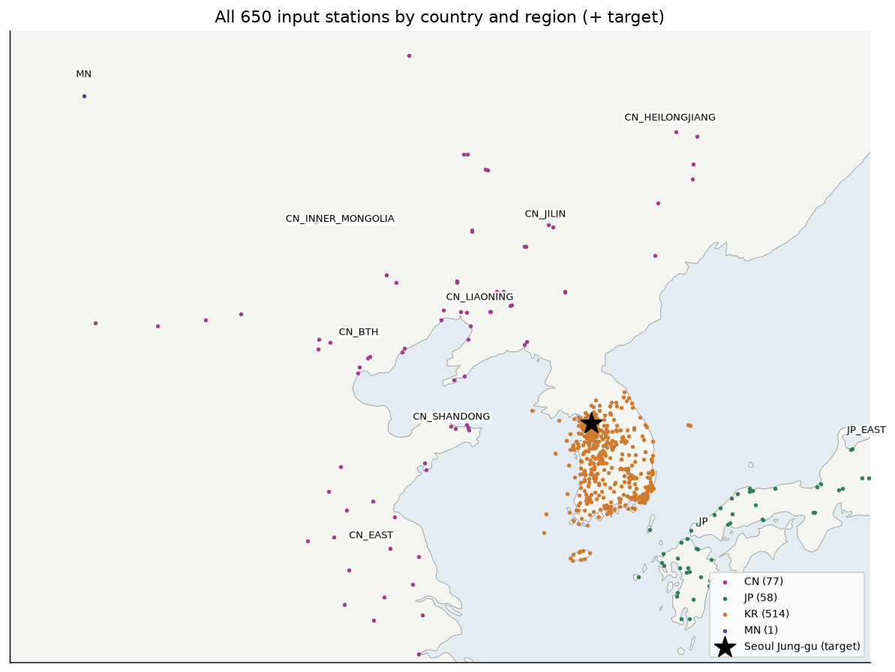

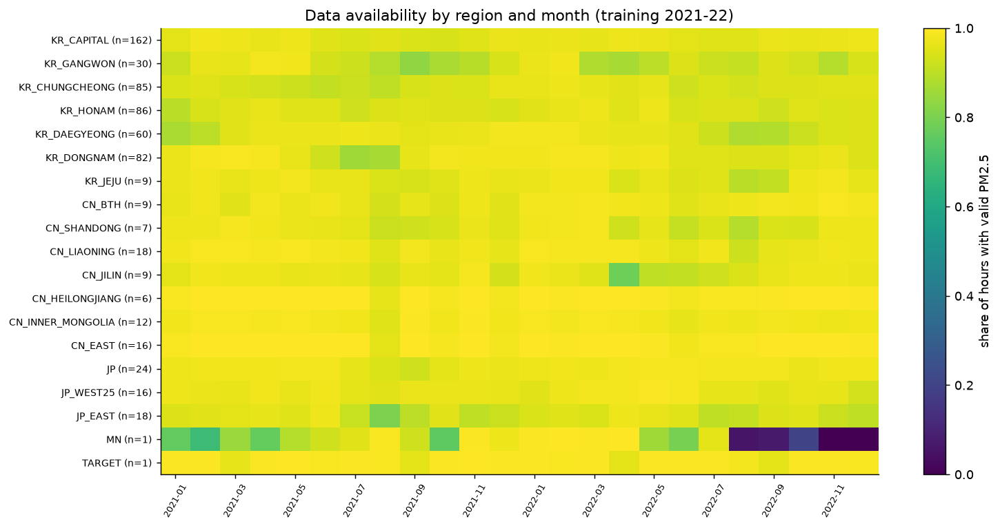

## E1. 자료 품질 (`eda_e1_quality.py`)

| 자료 | 결측 % | 최댓값 | > 500 | 24시간 이상 같은 값 | PM2.5 > PM10 |
|---|---|---|---|---|---|
| 국내 전국 | 5.5 | 803 | 9 | 4,039시간 | – |
| 국내 34곳 | 9.0 | 307 | 0 | 0 | 382 |
| 중국 48곳 | 3.4 | **9985** | 67 | 152 | **17,560** |
| 중국 국경 | 0.7 | 1,853 | 117 | 0 | 1,125 |
| 일본 서부 | 7.0 | 330 | 0 | 298 | – |
| 일본 동부 | 12.6 | 212 | 0 | 295 | – |
| 몽골 | 27.5 | 848 | 117 | 0 | 0 |

- **일본 음수:** 서부 10.9만 시간, 동부 12.4만 시간이 음수라 결측으로 처리되어 있습니다. 깨끗한 날의 측정 잡음입니다.
- **공백:** 몽골은 최장 2,052시간(약 3개월) 연속 결측이 있습니다. 국내에도 수개월 공백이 있는 측정소가 있습니다(`tables/e1_gaps_by_region.csv`).
- **ASOS:** 기온·습도·기압·바람은 결측이 거의 없습니다. 강수는 88–89%가 공란입니다.
- **시사점:** 모델은 이상치를 자르지 않고 그대로 학습했습니다. 9985 같은 명백한 오류값은 다음 실험부터 제외하는 것이 맞습니다.

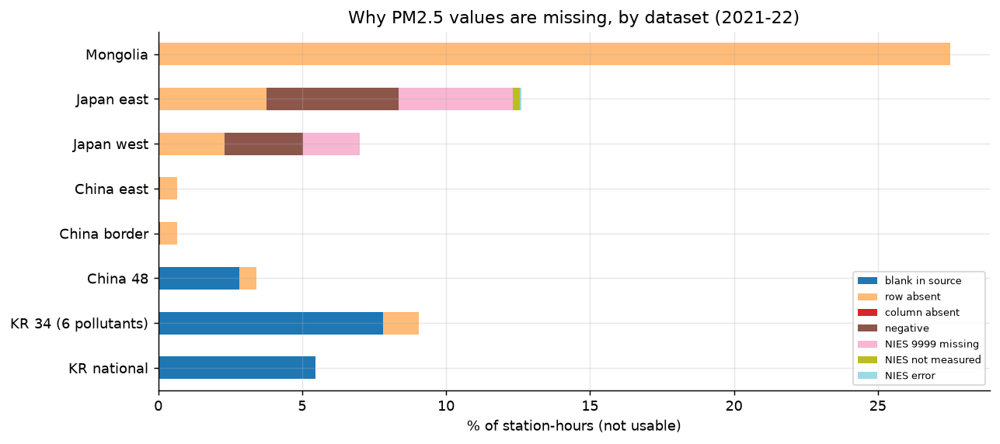

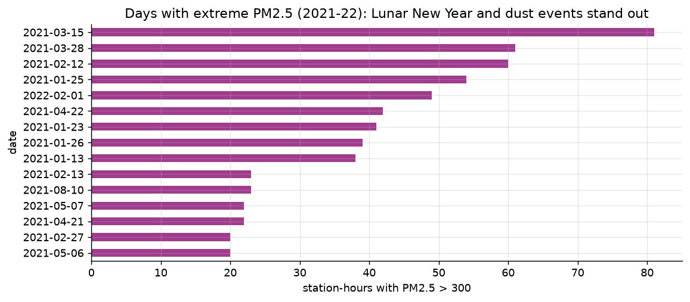

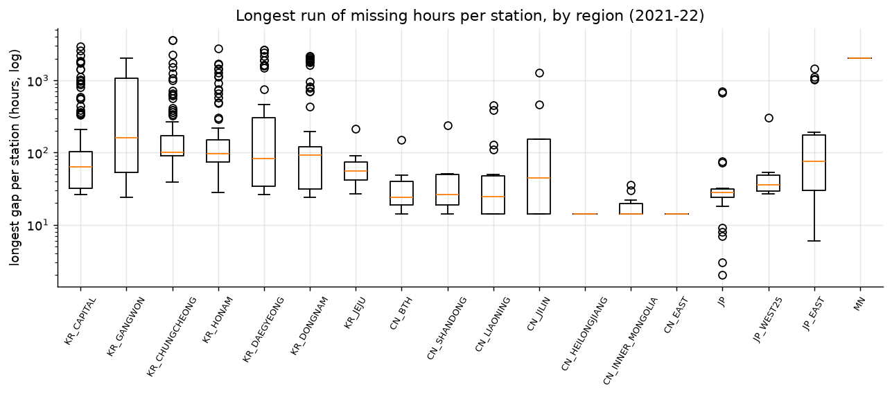

## E2. 서울 중구 시계열 (`eda_e2_target.py`)

- **분포:** 평균 20.0, 중앙값 16, 99% 분위 84, 최대 172 µg/m³입니다. 오른쪽으로 긴 꼬리가 있어서 모델은 log1p로 변환해 씁니다.
- **주기:** 11–3월이 높고 8–9월이 가장 낮습니다.
  - 35 µg/m³ 초과 시간은 2월 25%, 8월 0.6%입니다.
  - 요일 차이는 작습니다(금·토가 약간 높음).
  - 겨울에는 오전 11시 전후에 높습니다.
- **분해(MSTL):** 분산 비중은 추세 38%, 하루 주기 4%, 주 주기 8%, 잔차 51%입니다. 주기만으로는 예측할 수 없습니다.
- **정상성:** ADF는 정상, KPSS는 비정상으로 결론이 갈립니다. 계절 추세가 있는 약한 비정상 시계열입니다.
- **지평별 변화:** 학습 구간 Persistence RMSE는 7.3 / 10.2 / 13.5 / 16.9입니다. 현재 값과의 상관은 0.90 / 0.80 / 0.65 / 0.45로 떨어집니다.
- **고농도:** 35 초과는 283회 있었습니다. 지속 시간 중앙값은 3시간이고, 93%가 하루 안에 끝납니다. 75 초과는 32회이고 11–3월에 몰려 있습니다.
- **명절:** 2021 설날 직후 사흘 평균이 25 → 65로 뛰었습니다. 중국 설 불꽃놀이와 같은 날이며, 같은 날 중국 측정소에도 극단값이 몰려 있습니다(E1).

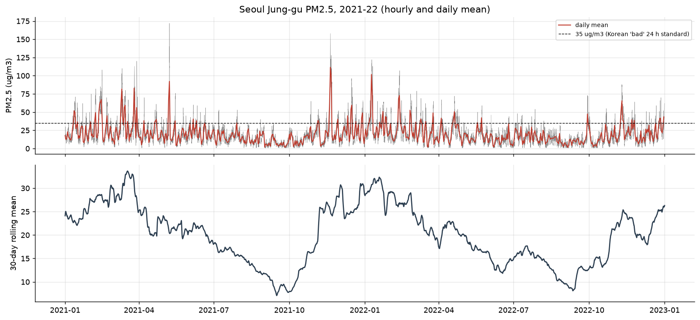

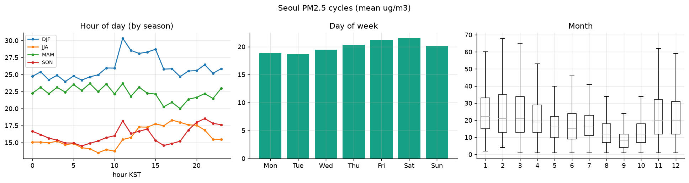

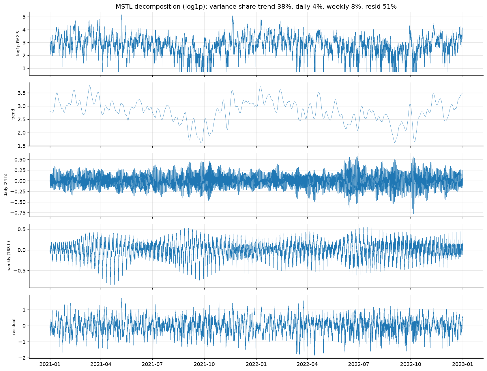

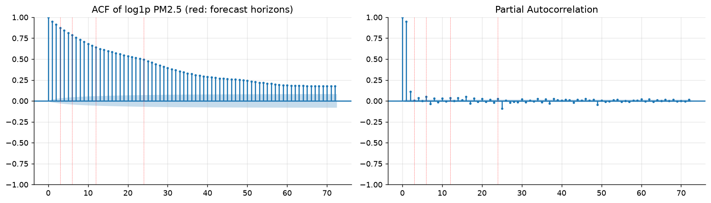

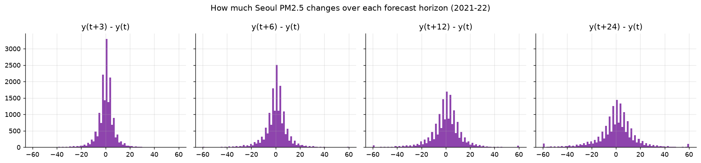

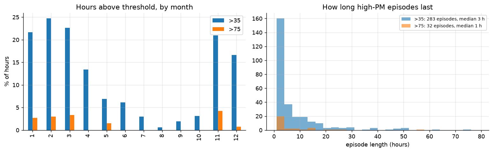

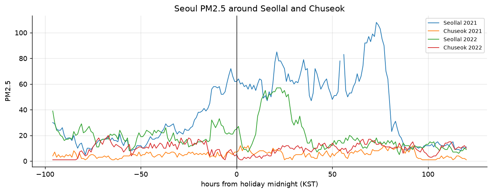

## E5. 이동경로 (`eda_e5_trajectories.py`)

500 m에 도착하는 48시간 역궤적 5,840개를 k-means로 6개 경로로 나눴습니다.

| 경로 | 비율 | 서울 PM 평균 | 35 초과 비율 | 48시간 이동 거리 |
|---|---|---|---|---|
| C1 남서, 느림 (정체) | 29% | 23.4 | 17% | 598 km |
| C2 동쪽 | 16% | **10.3** | 1% | 1,043 km |
| C3 서쪽(서해 횡단) | 19% | **26.9** | **21%** | 1,181 km |
| C4 남서 | 13% | 20.5 | 11% | 1,252 km |
| C5 북서, 빠름 | 13% | 15.9 | 6% | 1,854 km |
| C6 북서, 매우 빠름 | 9% | 16.7 | 7% | 2,505 km |

- **계절:** 겨울은 북서(51%)·서쪽(26%) 경로가 많고, 여름은 남서(67%)·동쪽(20%) 경로가 많습니다. 경로와 계절이 겹쳐 있으므로 해석할 때 함께 봐야 합니다.
- **경로 조건:** 이동 거리(속도), 도착 혼합고, 경로상 24시간 강수는 모두 서울 PM과 음의 관계입니다(스피어만 −0.24, −0.16, −0.35).
- **CWT/PSCF:** 고농도 공기는 서해와 산둥·장쑤 연안, 한반도 서부를 지나온 경우가 많습니다.
- **권역 통과:** 산둥(12%)·징진지(7%)·중국 동부(6%) 근처를 지나온 날은 서울 PM이 26–31로 평균(19–20)보다 높습니다. 하지만 이런 날은 드뭅니다.
  - 랴오닝은 38%로 자주 지나오지만 차이가 작습니다(21 vs 19).
  - 일본·헤이룽장 쪽에서 온 날은 낮습니다.

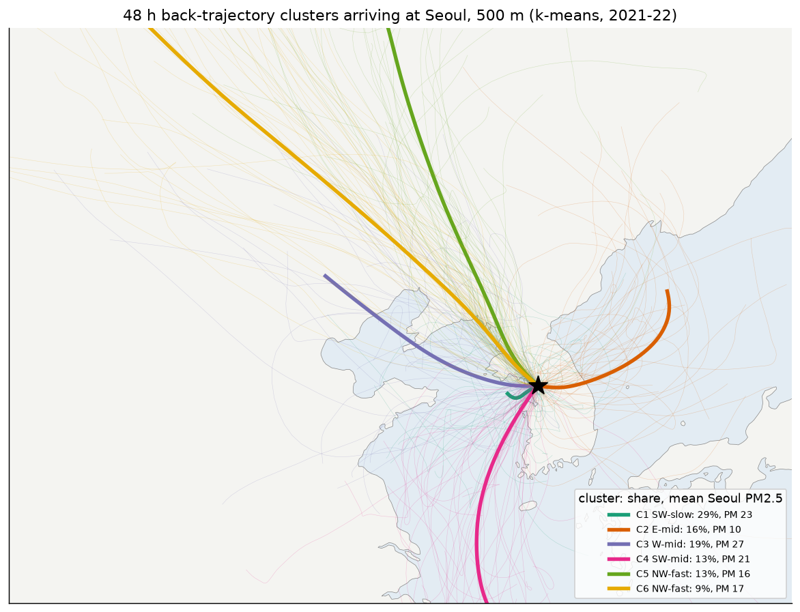

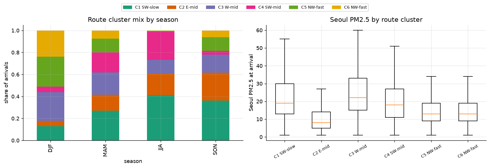

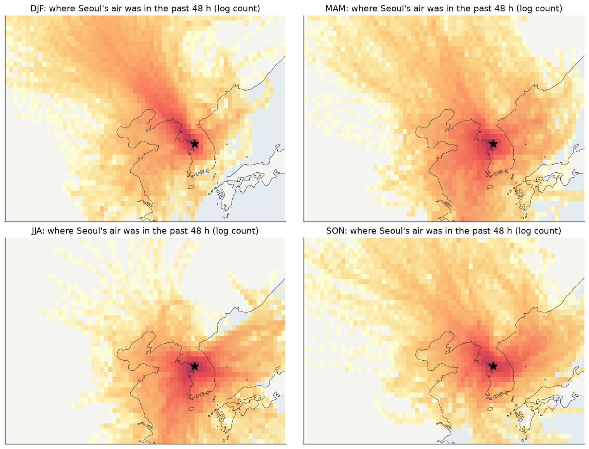

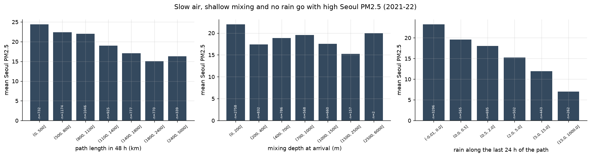

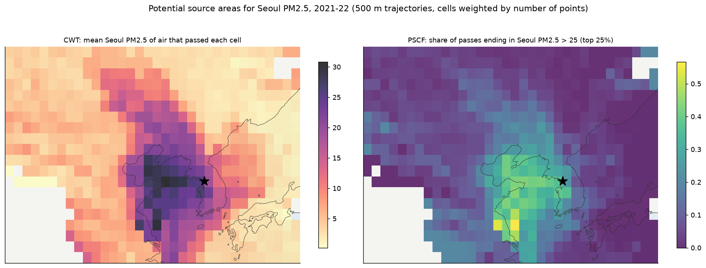

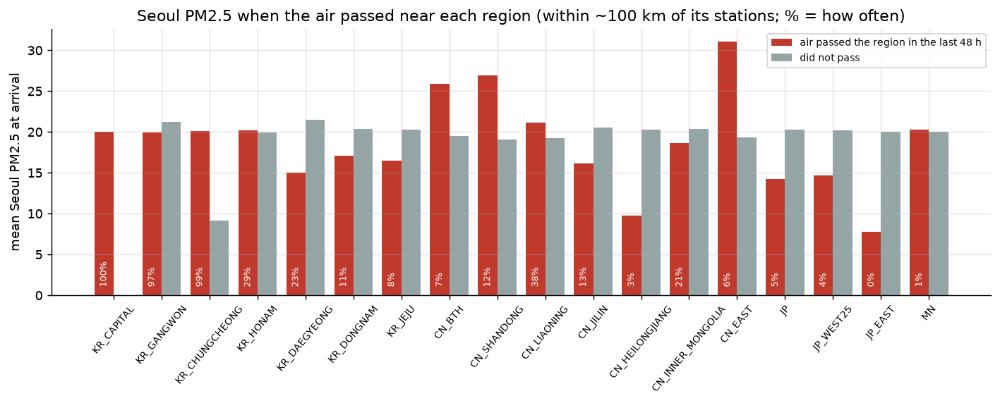

## E9. 모델 오차 (`eda_e9_model_errors.py`, 2023 검증)

C_GRU의 F(전체 측정소)와 DN(국내만)을 비교했습니다. 둘 다 시드 3개 평균입니다. 예측 시점 t에 도착한 궤적의 경로 군집으로 나눴습니다.

**F − DN RMSE 차이 (음수 = 해외 정보가 도움)**

| 경로 | 3 h | 6 h | 12 h | 24 h |
|---|---|---|---|---|
| C1 남서, 느림 | −0.08 | −0.13 | −0.45 | **−1.51** |
| C2 동쪽 | −0.08 | +0.05 | +0.22 | +0.07 |
| C3 서쪽 | −0.18 | +0.07 | +0.27 | **−0.75** |
| C4 남서 | +0.03 | −0.09 | −0.02 | +0.20 |
| C5 북서, 빠름 | +0.04 | −0.03 | +0.02 | −0.40 |
| C6 북서, 매우 빠름 | +0.28 | +0.38 | +0.69 | −0.25 |

- **경로별 오차:** 서쪽 경로(C3)가 가장 어렵습니다(24시간 RMSE 15.6). 북서 경로는 쉽습니다(6.5).
- **해외 정보의 효과:** 24시간에서 정체·서쪽 경로일 때 크게 줄어듭니다. 계절로는 겨울 24시간(−1.10)에서 가장 큽니다.
- **고농도 과소예측:** 75 µg/m³ 초과 시점은 24시간 예측에서 평균 53 µg/m³ 낮게 예측합니다. 반대로 15 이하인 깨끗한 날은 약간 과대예측합니다. 평균으로 끌려가는 경향입니다.
- **시사점:** 해외 정보를 항상 넣는 대신, **경로에 따라 쓰는 방식**(경로별 모델, 궤적 가중 변수)이 다음 실험으로 맞습니다.

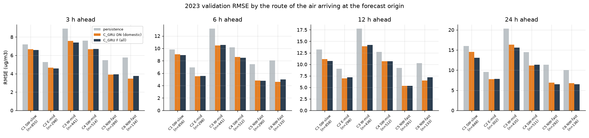

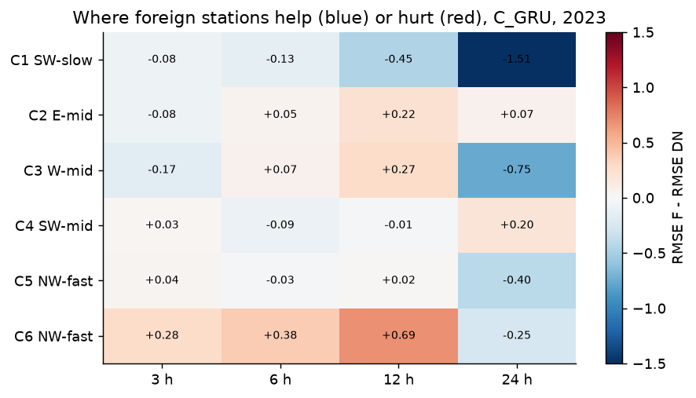

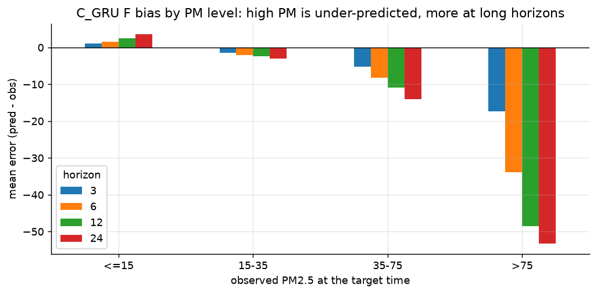

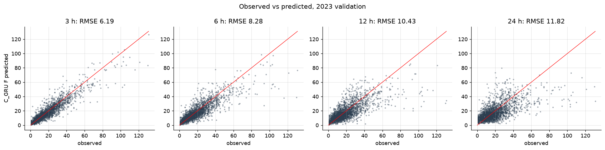

## 다음 단계 (PLAN.md의 2·3단계)

- E3 기상 관계
- E4 공간 구조(거리 상관, 수송 시차)
- E6 수송 사건(설날 펄스, 황사, 백령도 관문)
- E7 성분 비율
- E8 예측 관점
