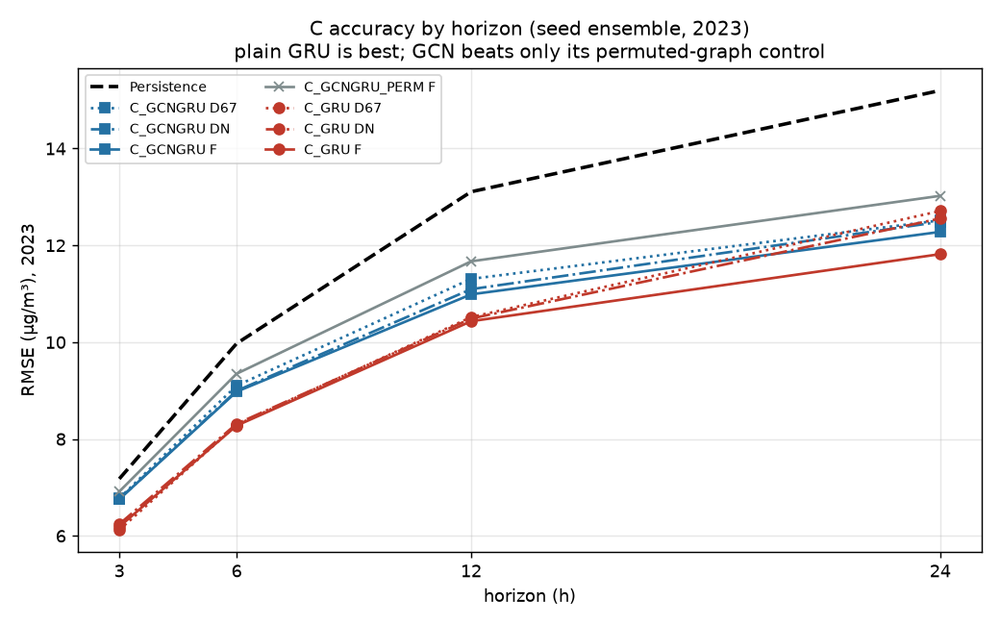
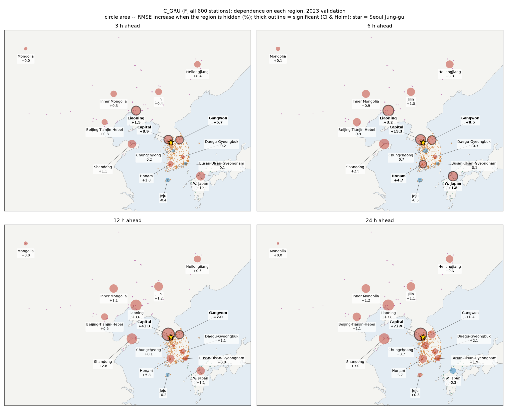

# TSA-PM2.5-Forecasting-in-Seoul
Time Series Analysis PM2.5 Forecasting in Seoul Project

**Team06 · 시계열데이터분석및실습**

## 프로젝트 개요

서울 중구(측정소 111121) PM2.5의 **3·6·12·24시간 뒤 값**을 예측합니다.

**연구 질문**
1. 국외(중국·일본·몽골) 관측은 국내 관측만 쓸 때보다 예측을 개선하는가?
2. 개선한다면 어느 권역이, 어떤 조건(계절, 공기의 이동경로)에서 도움이 되는가?
3. 어떤 모델 구조가 그 정보를 잘 쓰는가?

## 데이터

| 구분 | 내용 |
|---|---|
| 예측 대상 | 서울 중구 시간별 PM2.5, 2021–2024 |
| 국내 관측 | 전국 측정소(국내 67곳 D67, 전국 DN) |
| 국외 관측 | 중국 48곳(징진지, 산둥, 랴오닝, 지린, 헤이룽장, 내몽골), 일본 서부, 몽골 울란바토르 |
| 대조 지역 | 공기가 거의 지나가지 않는 중국 동부, 일본 동해 쪽 |
| 기상 | ASOS 서울(108)·백령도(102) |
| 이동경로 | HYSPLIT 48시간 역궤적(500 m, 3시간 간격)과 궤적-측정소 매칭 |
| 분할 | 학습 2021–22 · 검증 2023 · 시험 2024 (시험은 한 번만 공개) |

원자료의 결측은 표시만 하고 채우지 않았습니다. 모델마다 학습 자료 기준으로 처리합니다. 데이터는 용량 때문에 이 저장소에 없습니다.

## 실험 설계

- **입력 조건**
  - 기본: D67, DN, F(전체)
  - ADD: 국내 기준선에 국외 권역 하나씩 추가
  - DROP: 전체에서 권역 하나씩 제외
  - CTRL: 대조 지역(음성 대조)
- **평가**
  - 모든 모델이 같은 평가 행과 Persistence 기준선을 씁니다.
  - DM 검정과 7일 블록 bootstrap을 쓰고 Holm 보정을 합니다.
  - 구간 상한 < 0 **그리고** Holm p < 0.05일 때만 "개선"으로 판정합니다.
- **시드:** 신경망과 LightGBM은 시드 11/22/33으로 학습해 평균 앙상블로 평가합니다.

## 모델

| 폴더 | 모델 | 내용 |
|---|---|---|
| [A](A/) | SARIMAX | 권역 평균 시차 변수를 넣은 선형 기준 모델과 그랜저 검정 |
| [B](B/) | LightGBM | 26개 입력 조건과 대조 3개, TreeSHAP 권역 기여 |
| [C](C/) | GRU / GCN-GRU | 측정소 그래프 순환신경망과 권역 가리기·재학습 비교 |
| [D](D/) | (팀원 담당) | |
| [EDA](EDA/) | 탐색 분석 | 학습 구간만 사용 |

## 폴더 구조

```
A/  B/  C/  D/  EDA/      모델별 코드와 설명
results/
  A/  B/  C/  D/          모델별 예측, 채점 결과, 분석 표와 그림
assets/                   지도 배경(Natural Earth)
requirements.txt
```

## 지금까지의 결과 (2023 검증, RMSE µg/m³)

| 모델 | 3 h | 6 h | 12 h | 24 h |
|---|---|---|---|---|
| Persistence | 7.18 | 9.97 | 13.11 | 15.20 |
| C_GRU | **6.19** | **8.28** | **10.43** | **11.82** |
| C_GCNGRU | 6.76 | 8.98 | 10.99 | 12.28 |



- **모델 구조:** 그래프 없는 GRU가 지리 그래프 GCN보다 낫습니다(3·6시간 유의).
- **국내 정보:** 수도권 관측은 다른 측정소로 대체할 수 없습니다.
- **국외 정보:** 학습된 모델은 랴오닝·산둥에 기댑니다. 하지만 그 권역을 빼고 다시 학습하면 차이가 사라집니다. 즉 그 정보는 다른 측정소로 대체됩니다.
- **계절:** 중국 의존도는 추운 계절에 큽니다.



모델 C의 자세한 내용은 [C/README.md](C/README.md)와 [results/C/RESULTS_C.md](results/C/RESULTS_C.md)에 있습니다. A·B·D 결과는 올리는 대로 추가합니다.
