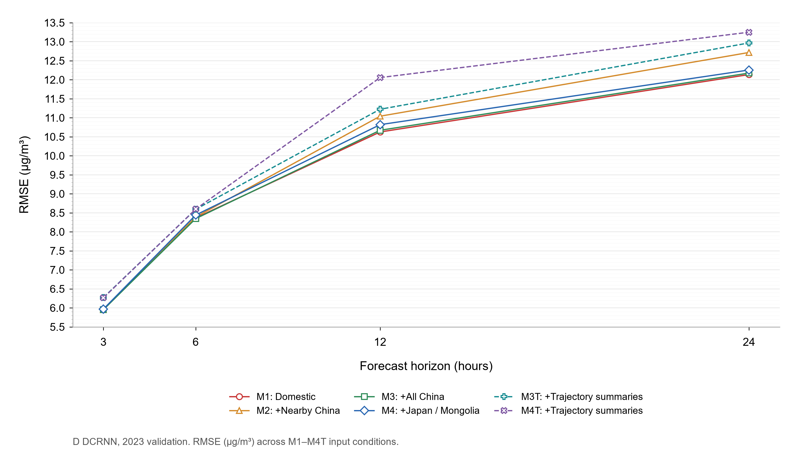

# DCRNN 실행 결과와 해석

이 폴더는 서울 중구 PM2.5 예측에서 입력 지역과 궤적 요약 변수의 추가 효과를 검토한 결과를 모았습니다. 학습 코드와 실행 안내는 [D 포털](../../../D/README.md)과 [실행 안내](../../../D/RUN_GUIDE.md)를 확인하세요.

현재 중간발표의 주 비교는 **2023 validation·3–24h**입니다. 2024 결과는 별도 preliminary 평가로 보관합니다.

## 자료 구성

| 폴더 | 무엇을 나타내는가 | 이것으로 확인할 수 있는 것 |
|---|---|---|
| [presentation2023](presentation2023/) | 최신 가로형 M1–M4T RMSE 곡선·영문 문구·근거 표 | 2023년 3·6·12·24h의 전체 입력 조건 비교 |
| [h48_review](h48_review/) | 최신 H48 실행 감사와 2023·2024 통합 채점·학습 기록 | 수치 재검증, 학습 종료와 최적 epoch, 기준선·조건 비교 |
| [conditional_review](conditional_review/) | 계절·경로별 M3 vs M1 분석, 표본 수와 신뢰구간 | 평균 성능 뒤에 숨은 조건별 차이와 불확실성 |
| [historical_regional12](historical_regional12/) | 이전 DN/F와 국외 권역 개별 추가 실험 | 과거 실험의 진행 경과; 최신 H48과 구분하여 해석 |

각 폴더의 `Codes`는 분석을 만든 원본 코드 기록입니다. 원래 로컬 감사 코드는 `WORK`, `PROJECT`, 원본 ZIP 위치 같은 경로를 사용하므로, 재실행 전에 해당 코드의 README와 경로 설정을 확인합니다. 저장소 복사만으로 원본 ZIP·체크포인트·비공개 입력까지 준비되지는 않습니다.

## 최신 H48 실험의 고정 조건

실행 batch는 `20261112_003040_429483_85af4013`입니다. 2021–2022년에 학습하고 2023의 6h RMSE로 checkpoint를 선택했습니다. 아래 수치는 **seed 11 단일 실행**이며, 3시드 평균이나 앙상블이 아닙니다.

| 입력 조건 | 외부 PM2.5 관측 범위 | 추가 궤적 요약 변수 |
|---|---|---|
| M1 | 국내 514 | 없음 |
| M2 | 국내 514 + 서울 600 km 이내 중국 21 | 없음 |
| M3 | 국내 514 + 중국 77 | 없음 |
| M4 | M3 + 일본 42 + 몽골 1 | 없음 |
| M3T | M3와 같음 | 국내·중국 218개 |
| M4T | M4와 같음 | 전체 허용 국가 322개 |

모든 조건에서 같은 635노드와 학습구간 수송 방향 그래프가 유지됩니다. 제외 관측은 정규화 전에 가리며 노드는 잠재 전달 노드로 남습니다. M1도 공통 수송 그래프를 사용합니다. 따라서 T 조건은 **수송 그래프 자체의 유무**가 아니라 **추가 요약 변수의 효과**를 검증합니다.

실제 H48 입력은 외부 F634 구성입니다. 중국·일본 동부 추가 전 F600 관측망을 설명하는 막대그래프를 이 실행의 입력 수로 해석하면 안 됩니다.

## 2023 validation — 중간발표 주 결과

RMSE 단위는 µg/m³이며 낮을수록 좋습니다. 자세한 수치는 [validation_condition_metrics.csv](h48_review/Results/Tables/validation_condition_metrics.csv)와 [사전 비교표](h48_review/Results/Tables/validation_predeclared_condition_comparisons.csv)에 있습니다.

| 조건 | 3h | 6h | 12h | 24h |
|---|---:|---:|---:|---:|
| M1 | 5.961 | 8.366 | **10.626** | **12.136** |
| M2 | **5.954** | 8.389 | 11.041 | 12.717 |
| M3 | 5.955 | **8.347** | 10.671 | 12.175 |
| M4 | 5.969 | 8.441 | 10.818 | 12.257 |
| M3T | 6.273 | 8.592 | 11.224 | 12.968 |
| M4T | 6.265 | 8.596 | 12.057 | 13.250 |

- 국내 PM2.5 입력만 사용하는 M1은 12·24h에서 수치상 최저 RMSE를 보였습니다.
- 3·6h의 중국 추가 이득은 M1 대비 각각 최대 약 0.12%·0.22%로 작았습니다.
- M3T는 M3보다, M4T는 M4보다 네 예측시간 모두 RMSE가 높았습니다.
- **3–24h 사전 입력 비교 28개에서 통계적으로 유의한 개선이나 악화는 확인되지 않았습니다.** 수치상 상승만으로 궤적의 해로움을 확정하지 않습니다.

발표용 최종 그림은 [presentation2023/Results](presentation2023/Results/)에 PNG·SVG·PDF로 있습니다. y축은 0.1 보조 눈금, 0.5 숫자 표시이며, 16:9 가로형 디자인입니다. 최신 주석에는 `D DCRNN, 2023 validation`과 그림 설명을 사용합니다. 범위는 값이 잘리지 않도록 5.5–13.5입니다.

### 36·48h 확장 결과

3–24h와 구분하여 봅니다. 2023년 36·48h에서는 M3가 M2보다 유의하게 좋았고, M2는 M1보다 유의하게 나빴습니다. 이는 **M3가 국내 기준선 M1보다 유의하게 좋았다는 뜻이 아닙니다.** 전 지평을 묶어 “모든 입력 비교가 유의하지 않았다”고 요약하지 않습니다.

## 왜 궤적 요약 변수가 도움이 되지 않았을까?

현재 결론은 **“이 요약·결합 방식에서 안정적인 추가 이득을 얻지 못했다”**입니다. 아래는 검증할 가설이며 원인으로 확정한 내용이 아닙니다.

| 가능한 설명 | 대응하는 후속 실험 |
|---|---|
| 기존 수송 그래프와 요약 변수의 정보 중복·잡음 | 핵심 변수 선택, 변수 묶음별 단계적 추가 |
| 경로·상황별 가치가 다른 정보를 일괄 결합 | 경로·계절에 따른 선택적 입력 또는 게이트 비교 |
| 추가 정보에 맞지 않는 학습·checkpoint 선택 설정 | 정규화·차원 축소 검증, 6h 중심 선택과 다중 지평 선택의 별도 비교 |

T 조건에서 훈련 오차는 더 낮아졌지만 검증 6h 오차는 더 높았습니다. 다만 teacher forcing 훈련 손실과 free-running 검증 손실은 조건이 다르며, 단일 시드 결과만으로 과적합을 확정할 수 없습니다. 모델 파라미터 수와 문맥 입력 폭은 조건 간 동일하게 고정되어 있습니다.

## 2024 preliminary 평가

2024는 이미 개발 중 확인한 기간입니다. 여기서 얻은 결과를 개선 방향에 활용한 이후 같은 기간을 완전히 독립적인 최종 블라인드 시험이라고 표현하지 않습니다.

수치는 [test_rmse_matrix.csv](h48_review/Results/Tables/test_rmse_matrix.csv), [통합 입력 비교](h48_review/Results/Tables/test_predeclared_condition_comparisons.csv)를 확인합니다. 2024의 사전 입력 비교 42개에서는 유의한 개선·악화가 없었습니다. 일부 조건·예측시간의 수치상 개선은 있었지만 국외 관측이나 요약 변수의 일관된 이득은 확인되지 않았습니다.

원본 주 실행 감사의 `Results/Figures`에는 주로 **2024 3–48h** 그림이 있습니다. `presentation2023`과 평가 연도가 다르므로 슬라이드에서 바꿔 쓰지 않습니다.

## 계절·수송경로별 분석

[conditional_review/README.md](conditional_review/README.md)는 계절·경로 조건의 정의, 표본 수, paired calendar-block bootstrap 신뢰구간, 연도 간 방향 일관성을 설명합니다. 조건별 분석은 평균 결과에서 보이지 않는 차이를 찾는 탐색적 근거입니다.

일부 조건에서 개선이 커 보이거나 신뢰구간이 양수여도 원래 다중 비교 기준을 모두 충족하지 않을 수 있습니다. 2023년에는 중구 정답의 약 44일 결측으로 겨울 분석에도 제약이 있습니다. 표본 수·불확실성·계절 혼합을 함께 확인합니다.

경로 통과 빈도는 공기덩이의 이동 빈도이며, 국가별 배출원 기여율이 아닙니다. 관측소 추가 이득·모델 의존도·실제 오염물질 기원도 서로 구분합니다.

## 채점과 재현 기록

- 조건별 `n`이 같은 것은 지평별 고정 평가 행을 사용했기 때문입니다. 지평끼리는 정답 결측과 연도 경계 때문에 표본 수가 다릅니다.
- 원본 통합 채점의 Holm 가족은 **연도별 84개**입니다. 기준선 관련 42개와 사전 입력 비교 42개를 함께 보정하며, 2023·2024를 단순히 합쳐 만든 84개가 아닙니다.
- 3–24h 그림에서는 원래 보정값을 그대로 사용합니다. 표시한 28개만으로 새로 보정하지 않습니다.
- `h48_review/Results/Original_Combined`에 원본 통합 채점 파일을 보관합니다. `metrics.csv`, `tests.csv`, `conditions.csv`, `seed_metric_summary.csv`, `score_rows.parquet` 등의 출력 형식을 확인할 수 있습니다.
- 팀원·이전 모델 비교는 입력 범위, 평가 연도·행, 시드 평균/앙상블 여부를 먼저 맞춰야 합니다. 사후 비교 결과를 사전 가설 검정과 구분합니다.
- 그림·표 생성 코드와 감사 기록은 원본을 보존한 복사본입니다. 로컬 절대경로를 사용하는 감사 코드가 있으므로 재실행에는 해당 README와 입력 준비가 필요합니다.

추가 데이터·가중치·개인 인증정보를 제공하는 폴더는 아닙니다. 새 실행 결과는 각 실행 ID별 별도 폴더로 보관하고 기존 공유 결과를 덮어쓰지 않습니다.
