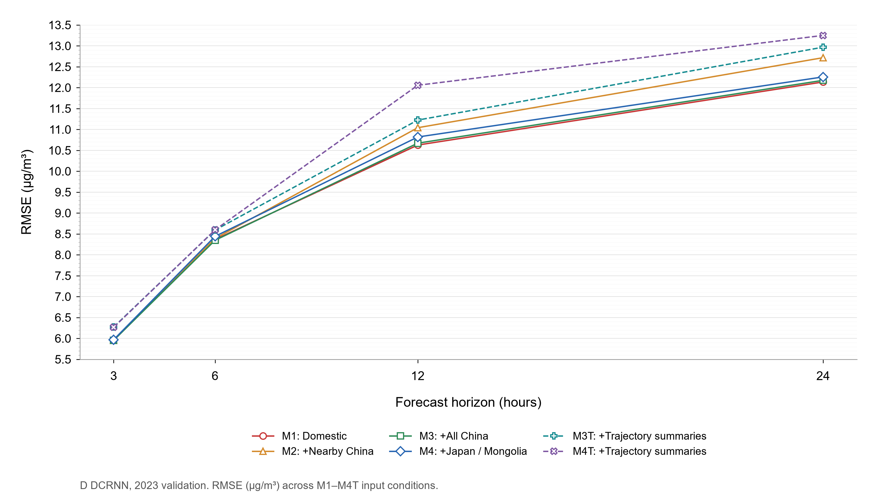

# DCRNN 2023 validation 발표용 성능곡선

M1–M4T의 3·6·12·24h RMSE를 동일 평가 행에서 비교합니다. 가로 16:9, 0.1 보조 눈금과 0.5 숫자 눈금을 사용합니다.
이 그림은 **F634, seed 11 단일 실행**입니다. 시드 문구를 그림에서 생략했지만 3시드 평균이 아닙니다.



- 3h 최저는 M2, 6h는 M3, 12·24h는 M1입니다.
- 3–24h의 사전 입력 비교 28개에서 통계적으로 유의한 개선·악화는 확인되지 않았습니다.
- M3T/M4T는 대응하는 M3/M4보다 네 지평 모두 RMSE가 높았지만, 유의한 악화라고 단정하지 않습니다.
- 36·48h의 일부 유의 비교는 이 그림 범위 밖입니다. 전체 지평에 유의성이 없다고 확장하지 마세요.

[영문 슬라이드 문구](Results/slide_copy_en.txt), [지표표](Results/validation_metrics_3_24h.csv),
[기존 검정 결과](Results/validation_comparisons_3_24h.csv), [그림 코드](Codes/plot_validation_caption.py)를 포함합니다.
검정의 Holm 가족 크기 84를 유지했으며 그림 범위가 줄었다고 보정을 다시 계산하지 않았습니다.

저장된 Evidence만으로 재그리기:

```bash
python D/reproduce_figure.py validation_curve
```

저장소 루트에서 실행합니다. 새 결과는 매번 별도 실행 폴더에 저장됩니다.
